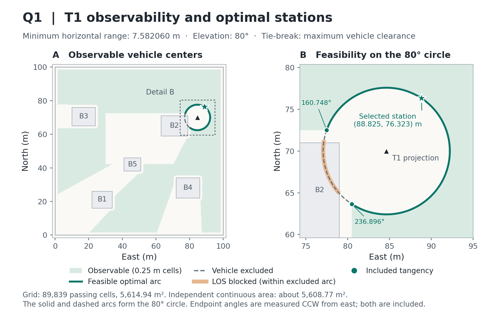
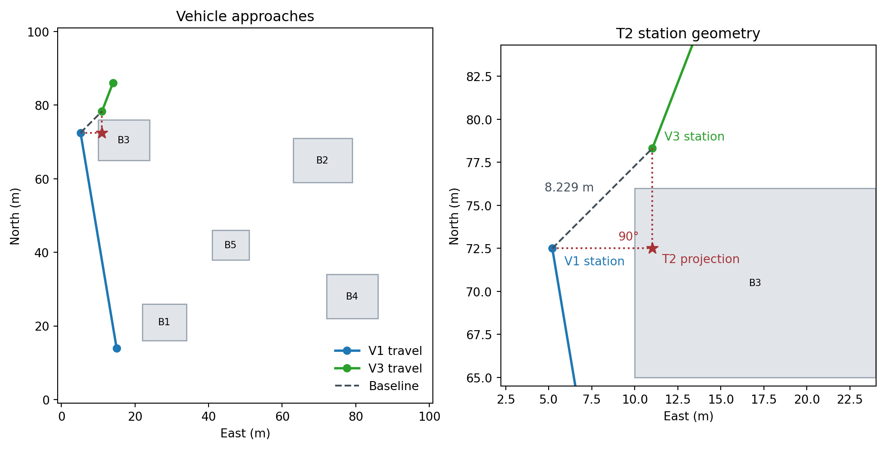
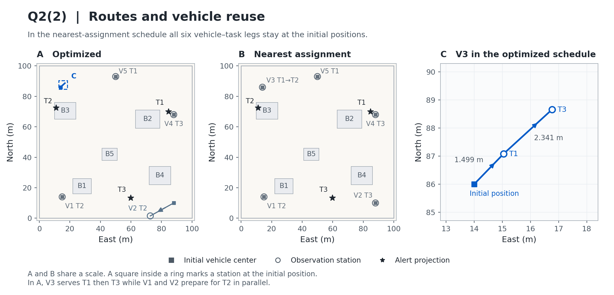
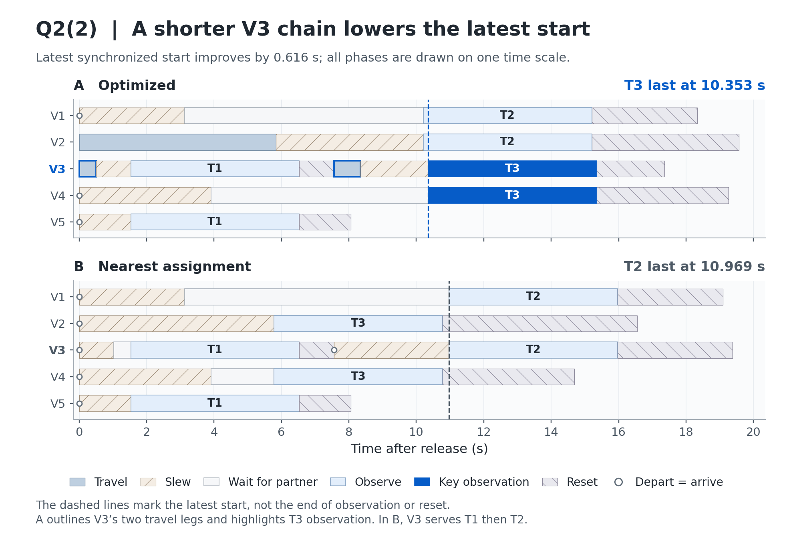

# SWBMCM2026

本仓库用于三人团队备战和参加 2026 年数维杯全国大学生数学建模挑战赛（秋季赛），记录备赛调研与历年赛题演练，并组织正式比赛的建模代码、实验结果和论文。

## 项目目录

下面是团队约定的目录结构。目录随第一份实际内容创建，`qN` 代表实际小问编号，例如 `q3`。

```text
SWBMCM2026/
├── research/              # 专题调研，每篇笔记附参考文献
├── docs/
│   ├── modeling-notes.md  # 题意拆解、初步思路、假设和验证计划
│   └── decisions.md       # 关键决定、依据和受影响的结果
├── problem/
│   ├── A/、B/、C/、D/     # 官方题面及各题说明
│   ├── translations/     # 中文翻译和配图
│   ├── official/         # 承诺书、格式规范和提交流程
│   └── archives/         # 原始赛题包和模板包
├── data/
│   ├── README.md          # 数据来源、版本、获取方式和预期路径
│   └── raw/               # 原始数据，按题号存放
├── src/
│   ├── run.py             # 统一运行入口
│   ├── qN/                # 各小问的代码，按需要拆分模块
│   └── shared/            # 已有跨问复用的数据处理、模型或指标
├── configs/               # 各问的参数和实验配置
├── checks/                # 手算样例、约束复核和指标重算
├── results/
│   ├── README.md          # 关键结果的复跑方式和复核记录
│   └── qN/                # 正文采用的图表、底表和运行记录
├── paper/                 # 论文源稿、引用和样式，官方示例入口为 demo.tex
├── tools/                 # 提交打包等独立脚本
├── runs/                  # 本地实验输出
├── scratch/               # 本地草稿和临时探索
└── submission/            # 本地组装的最终提交材料
```

## B 题运行与正式结果入口

图集收录 12 张论文用图的 PDF、PNG 和逐图底表，Q1 另附全矢量 SVG。按原题逐问核验及只读重绘命令见以下索引。[中文审核报告](docs/B题四问_图表与作答证据审核报告.md) · [图集索引](docs/B题四问_图集索引.md) · [正式结果索引](results/README.md#审阅图集与只读重绘)

在仓库根目录运行，复现环境为 Linux、Python 3.13。已验收的依赖版本见 [configs/requirements-b.txt](configs/requirements-b.txt)。

```bash
python3 -m venv .venv
source .venv/bin/activate
nohup python3 -m pip install -r configs/requirements-b.txt
nohup env OPENBLAS_NUM_THREADS=1 OMP_NUM_THREADS=1 MPLBACKEND=Agg python3 -B -m pytest -q -p no:cacheprovider checks
```

四问均通过 `python3 -B -m src.run qN --profile full --config <归档配置>` 复跑。命令打印新建的本地 `runs/qN/` 路径，不覆盖 `results/`。下表区分正式采用的结果与保留的对照；各问的确切命令和验收入口见[正式结果索引](results/README.md)。

| 小问 | 正式配置 | 正式采用与对照 |
| --- | --- | --- |
| Q1 | [归档配置](results/q1/可观测区域与最优站位_连续圆弧_20261120/config.yaml) | [连续弧与净空择优](results/q1/可观测区域与最优站位_连续圆弧_20261120/summary.json)；网格用于区域离散展示，投影约束优化另作对照。 |
| Q2 | [归档配置](results/q2/双站定位与并发调度_连续站位_20261120/config.yaml) | [双站解析方案](results/q2/双站定位与并发调度_连续站位_20261120/q21_result.json)与[细化站位调度 `optimized`](results/q2/双站定位与并发调度_连续站位_20261120/q22_comparison.json)。就近 `greedy` 和 `fixed_vehicles` 为对照；不指定 `--config` 会跑不含细化站的原网格实验。 |
| Q3 | [归档配置](results/q3/测向可靠性与80米定位约束_五方法对照_20261120/config.yaml) | [一维投影正态自适应积分](results/q3/测向可靠性与80米定位约束_五方法对照_20261120/limits.csv)给出两种指向口径的正式阈值；其余四种方法用于对照。 |
| Q4 | [归档配置](results/q4/扰动重调度_四模型择优_20261120/config.yaml) | [逐情景指标](results/q4/扰动重调度_四模型择优_20261120/scenario_metrics.csv)中，主结果筛选 `sample=main, variant=main, model=recommended`；最佳单模型 `cp_sat` 与其他模型和两种基线分行保留。 |

## 第一问结果（B 题，2026-11-20）

**状态：** 已完成并复核。代码在 `src/q1/`，正式结果在 [`results/q1/可观测区域与最优站位_连续圆弧_20261120/`](results/q1/可观测区域与最优站位_连续圆弧_20261120/conclusions.md)，原始运行目录为 `runs/q1/20261120T105624Z_byf9quhb/`（`runs/` 按约定只留本地，不入库）。

**主要结果**

| 项目 | 结果 |
|---|---|
| 主目标 | 最大化 \(Q=1/r\)，等价于最小化到 \(T_1\) 的水平距离 |
| 最优水平距离 | \(r^*=7.582060170464\) m（由 \(43/\tan80^\circ\) 解析得到） |
| 最优观测质量 | \(Q^*=0.131890274875\) m\(^{-1}\) |
| 最优仰角 | \(80^\circ\) |
| 完整并列解 | 以 \(T_1\) 水平投影为圆心、半径 \(r_0\) 的连续圆弧，角域 \([0^\circ,160.747873328^\circ]\cup[236.896046854^\circ,360^\circ)\) |
| 推荐站位 | \((88.825410107,\ 76.322854075)\) m，圆周角约 \(56.503855631^\circ\) |
| 最小车辆净空 | \(9.6745898929\) m，受场地东界与 B2 东北角共同限制 |
| 可观测面积 | 0.25 m 网格 \(5614.9375\) m\(^2\)；连续截面包围 \([5608.767083,5608.774146]\) m\(^2\)，建议采用约 \(5608.77\) m\(^2\) |

**并列解选择规则：** 先保留达到 \(Q^*\) 的全部站点；在整条最优弧上最大化最小车辆净空（车体外缘到四条场界和五栋建筑底面的最短距离）；净空仍在浮点余量内并列时，按 \(x\) 升序、再按 \(y\) 升序。净空择优的全域上界差为 \(9.15\times10^{-13}\) m。

**图与底表**



- [矢量 PDF](results/q1/可观测域与最优弧_青绿矢量图集_20261121/q1_observability.pdf) · [SVG](results/q1/可观测域与最优弧_青绿矢量图集_20261121/q1_observability.svg) · [上一版配色](results/q1/可观测域与最优弧_论文配色图集_20261121/q1_observability.pdf) · [首版审阅图](results/q1/可观测域与最优弧_审阅图集_20261121/q1_observability.pdf) · [历史全场图](results/q1/可观测区域与最优站位_连续圆弧_20261120/observable_region.png) · [历史圆弧图](results/q1/可观测区域与最优站位_连续圆弧_20261120/optimal_arcs.png)
- 其他图：[三约束独立掩码](<results/q1/可观测区域与最优站位_连续圆弧_20261120/constraint_masks.png>)、[净空曲线](<results/q1/可观测区域与最优站位_连续圆弧_20261120/clearance_profile.png>)、[分辨率对照](<results/q1/可观测区域与最优站位_连续圆弧_20261120/resolution_comparison.png>)、[场地布局](<results/q1/可观测区域与最优站位_连续圆弧_20261120/field_layout.png>)
- 底表：[代表站点](<results/q1/可观测区域与最优站位_连续圆弧_20261120/station_table.csv>)、[最优弧端点](<results/q1/可观测区域与最优站位_连续圆弧_20261120/optimal_arcs.csv>)、[网格统计](<results/q1/可观测区域与最优站位_连续圆弧_20261120/region_counts.csv>)
- 结果说明：[中文结论](<results/q1/可观测区域与最优站位_连续圆弧_20261120/conclusions.md>)、[运行记录](<results/q1/可观测区域与最优站位_连续圆弧_20261120/run_record.md>)、[完整结果 JSON](<results/q1/可观测区域与最优站位_连续圆弧_20261120/summary.json>)
- 独立复核：[连续面积包围](<results/q1/可观测区域与最优站位_连续圆弧_20261120/area_check_continuous.md>)、[二维投影约束规划对照](<results/q1/可观测区域与最优站位_连续圆弧_20261120/model_comparison_projected_nlp.md>)

**复跑**

```bash
nohup python3 -B -m src.run q1 --profile full \
  --config results/q1/可观测区域与最优站位_连续圆弧_20261120/config.yaml
```

第一问自动测试（37 项）：`nohup python3 -B -m pytest -q -p no:cacheprovider checks/test_q1*.py`。

## 第二问结果（B 题，2026-11-20）

结果、英文论文图表和运行记录保存在 `results/q2/双站定位与并发调度_连续站位_20261120/`。求解入口为 `src.run q2`，代码在 `src/q2/`，独立验收脚本在 `checks/`。 [归档结论](results/q2/双站定位与并发调度_连续站位_20261120/conclusions.md) · [英文图表](results/q2/双站定位与并发调度_连续站位_20261120/tables_and_figures.md) · [运行记录](results/q2/双站定位与并发调度_连续站位_20261120/run_record.md)

### 2（1）双站定位精度与 T2 最优站位

以一阶二维水平定位均方根误差 $E=\sigma\sqrt{r_1^2+r_2^2}/|\sin\gamma|$ 为精度指标。其中 $r_i$ 为各站到目标的水平距离，$\gamma$ 为水平交会角，两车的独立测角误差标准差均为 $\sigma=\pi/180$ rad。该指标同时计入两个水平分量，对坐标旋转不变，单位为米。基线 $B$ 通过 $B^2=r_1^2+r_2^2-2r_1r_2\cos\gamma$ 进入交会几何。

**Table 1. Optimal station pair and travel times for T2.**

| Vehicle | Station center (m) | Range to T2 (m) | Travel distance (m) | Travel time (s) | Elevation |
| --- | --- | ---: | ---: | ---: | ---: |
| V1 | (5.210066466, 72.500000000) | 5.818790363 | 59.313513 | 19.771171 | 80° |
| V3 | (11.028856830, 78.318790363) | 5.818790363 | 8.235816 | 2.745272 | 80° |

两站同时达到仰角约束给出的距离下界，基线 **8.229012248 m**、交会角 **90°**，取得指标最小值 **0.143623358 m**。两车的直达路段、30 s 行驶时限和三维视线均通过独立验收。近共线时优先换站，严格共线时剔除配对；合法的仰角与车体边界仍可使用，视线接触楼体时判为遮挡。 [解析站位与退化分析](results/q2/双站定位与并发调度_连续站位_20261120/conclusions.md) · [全精度站位和路线](results/q2/双站定位与并发调度_连续站位_20261120/q21_result.json) · [噪声及边界试验](results/q2/双站定位与并发调度_连续站位_20261120/q21_sensitivity.csv)



*Figure 1. Vehicle approaches and horizontal bearing geometry of the optimal T2 station pair. The projected sightlines cross B3; the 3D sightlines clear its roof.*

### 2（2）三告警分配、路线与五车时间轴

三条告警各用两辆车。分配与路线以最小化三条告警的最晚同步开测为目标。两车均到站并完成指向后共同观测 5 s，复用车在本车复位后出发。

**Table 2. Station assignments and synchronized observation start times.**

| Alert | Optimized station centers (m) | Start (s) | Nearest-assignment station centers (m) | Start (s) |
| --- | --- | ---: | --- | ---: |
| T1 | V3 (15.042, 87.078), V5 (50, 93) | 1.532033 | V3 (14, 86), V5 (50, 93) | 1.532033 |
| T2 | V1 (15, 14), V2 (72.680, 1.510) | 10.204157 | V1 (15, 14), V3 (14, 86) | **10.968984** |
| T3 | V3 (16.767, 88.660), V4 (88, 68) | **10.352849** | V2 (88, 10), V4 (88, 68) | 5.777589 |

就近法按两车避障路长之和贪心选择，路长并列时比较同步开测时间，并从六种处理顺序中取最好结果。优化由 V1、V2 并行准备 T2，让 V3 从 T1 接续 T3，缩短决定最晚开测的云台转向链。最晚开测提前 **0.616135 s（5.617%）**。连续场地的数值下界为 **10.352000 s**，与可行方案相差约 **0.849 ms**。原 1.25 m 档有限候选集的最优值为 10.731534 s。V3 的 T3 站靠近 B5 遮挡边界，复跑使用表中的毫米级坐标。



*Figure 2. Routes on the same field scale; the inset shows both V3 legs. A square inside a ring marks a station at the vehicle's initial position.*



*Figure 3. Five-vehicle timelines. Open circles mark zero-duration travel legs; dashed lines mark the latest synchronized start, not the end of observation.*

- [配色版 PDF、首版与来源](docs/B题四问_图集索引.md#q2)
- 时间轴记录两套方案中每辆车的出发、到站、指向、等待、观测起止、复位及后续出发。 [完整五车时间轴](results/q2/双站定位与并发调度_连续站位_20261120/q22_timeline.csv)
- [分配底表](results/q2/双站定位与并发调度_连续站位_20261120/q22_assignments.csv) · [路线全路点](results/q2/双站定位与并发调度_连续站位_20261120/q22_routes.json) · [六序基线及关键链](results/q2/双站定位与并发调度_连续站位_20261120/q22_comparison.json)
- [独立验收](results/q2/双站定位与并发调度_连续站位_20261120/validation.json) · [连续域下界](results/q2/双站定位与并发调度_连续站位_20261120/continuous_bound.json) · [按原题逐项审核](docs/B_Question_2_Result_Audit.md)

**复跑归档结果**

```bash
nohup env OPENBLAS_NUM_THREADS=1 python3 -B -m src.run q2 --profile full \
  --config results/q2/双站定位与并发调度_连续站位_20261120/config.yaml
```

复跑路径由命令打印，新产物写入本地 `runs/q2/`。归档快照的第一、二问共 **49 项测试通过**。 [复跑和验收命令](results/q2/双站定位与并发调度_连续站位_20261120/run_record.md)

## 第三问结果（B 题，2026-11-20）

**选用方法：一维投影正态分段自适应积分。** 定位误差在两个水平方向独立且同方差，可在极坐标下解析消去径向变量。只对方位角积分，保留原始 `atan2` 几何与角度回绕，不依赖小角度近似。正式结果保存在 [`results/q3/测向可靠性与80米定位约束_五方法对照_20261120/`](results/q3/测向可靠性与80米定位约束_五方法对照_20261120/)。[按原题逐项审核](docs/B题第三问_实验结果审核.md) · [完整推导与验证](docs/B题第三问_方案审核与实现说明.md)

### 误差传播、最大允许里程与 80 m 约束

以车辆真位置为原点、真视线为正 $x$ 轴，已知目标位于 $(D,0)$，$D=40$ m。估计车位的误差分量 $\delta_x,\delta_y$ 独立服从 $N(0,\sigma(s)^2)$，其中每轴标准差 $\sigma(s)=0.3+0.02s$ m，$s$ 为累计行驶里程。令 $W(u)=((u+180)\bmod 360)-180$ 将度制角度折回 $[-180^\circ,180^\circ)$，则

$$
\alpha=\frac{180}{\pi}\operatorname{atan2}(-\delta_y,D-\delta_x),\qquad
\Delta\psi=W(\alpha),\qquad
\Delta\psi_{\mathrm{act}}=W(\alpha+\epsilon_0+\epsilon_c).
$$

[英文原题第 4–5 页](<problem/B/2026_“ShuWei Cup”B_Problem.pdf#page=4>)用软件指令角定义 $\Delta\psi$。云台零位与控制误差 $\epsilon_0,\epsilon_c$ 是标准差分别为 $0.8^\circ$ 和 $0.6^\circ$ 的零均值正态误差，两者独立且与车辆定位误差独立；它们只进入执行后的实际指向 $\Delta\psi_{\mathrm{act}}$。将合成的 $1^\circ$ 云台误差按给定指令角在各回绕成功窗内求概率，再对定位角取期望，即得实际指向达标率。

达标概率定义为 $R(\sigma)=\Pr(\lvert\Delta\psi\rvert\leq 5^\circ)$，实际指向口径用 $\Delta\psi_{\mathrm{act}}$ 替换 $\Delta\psi$。两种概率都随定位标准差严格下降，故满足 $R(\sigma)\geq 0.95$ 的最大累计里程为 $s_{\max}=(\sigma_*-0.3)/0.02$，其中 $\sigma_*$ 为各自的 95% 临界根。[临界点与两侧回代](results/q3/测向可靠性与80米定位约束_五方法对照_20261120/limits.csv)

| 角度口径 | 临界每轴标准差 (m) | 最大累计里程 (m) | 厘米档上限 (m) | 原参数在 80 m 的达标率 |
|---|---:|---:|---:|---:|
| 软件指令角（原题字面） | 1.778721312 | **73.936066** | 73.93 | 93.347323% |
| 实际指向（计入三类误差） | 1.636745169 | **66.837258** | 66.83 | 91.506823% |

对 $\sigma(s)=a+bs$，在 **80 m** 仍达标的完整可行域是 **$a,b\geq 0$ 且 $a+80b\leq\sigma_*$**。$a$ 以 m 计，$b$ 以 m/m 计，边界截距分别为 $a=\sigma_*$ 和 $b=\sigma_*/80$。保留 $a=0.30$ m 时，软件指令角与实际指向的 $b$ 上限分别约为 **0.0184840** 和 **0.0167093 m/m**。例如 $a=0.30$ m、$b=0.0167$ m/m，在 80 m 的实际指向达标率为 **95.008829%**；该例接近模型边界。[80 m 参数域图](results/q3/80米参数域与误差贡献_蓝灰配色图集_20261121/q3_parameters_80m.pdf) · [边界点回代](results/q3/测向可靠性与80米定位约束_五方法对照_20261120/ab_boundary_checks.csv)

### 五方法择优与结果验证

一阶泰勒用于量级和方差贡献解释，实际指向里程比精确几何结果偏高 **0.0850 m**；高阶 Gauss–Hermite 用于确定性复核，与主积分最大概率差为 $1.67\times10^{-15}$。独立高斯半平面法再核对两条临界根。直接 Monte Carlo 每工况抽样 500 万次，逐点 Wilson 区间覆盖 7/10 个主积分值，多工况同时区间覆盖 10/10；两条临界点前后 0.50 m 的四个抽样工况均正确判别。八组独立扰动的 Sobol 估计通过收敛核验。按归档配置重跑后，**七张关键底表的数值结果一致**（方法表的耗时和进程号随运行变化）；第三问 **19 项测试通过**。[五方法对照](results/q3/测向可靠性与80米定位约束_五方法对照_20261120/method_comparison.csv) · [收敛与抽样图](results/q3/测向可靠性与80米定位约束_五方法对照_20261120/method_validation.pdf) · [独立核查](results/q3/测向可靠性与80米定位约束_五方法对照_20261120/reference_check.json)

### 三类误差贡献与部署启示

实际指向的一阶方差分别来自定位项 $[(180/\pi)\sigma(s)/D]^2$、零位项 $0.8^2$ 和控制项 $0.6^2$（平方度）。完整几何的方差复算给出相同排序。

| 累计里程 | 车辆定位 | 云台零位 | 云台控制 |
|---|---:|---:|---:|
| 0 m | 15.59% | 54.02% | 30.39% |
| 66.837 m（实际指向临界） | 84.61% | 9.85% | 5.54% |
| 80 m | 88.10% | 7.61% | 4.28% |

短里程优先校准零位，长里程优先抑制定位漂移或途中重定位。80 m 时单独消除定位、零位或控制误差，实际指向达标率分别提升 **8.493、1.181、0.665 个百分点**，这些增益不可相加。原定位参数下即使消除两项云台误差，80 m 的达标率也只有 **93.3473%**，所以要达 95% 必须改善定位。**66.83 m** 是题设条件下按厘米向下取整的实际指向上限，现场使用还需按实测误差留裕量。[贡献与消融底表](results/q3/测向可靠性与80米定位约束_五方法对照_20261120/error_contributions.csv) · [误差贡献图](results/q3/80米参数域与误差贡献_蓝灰配色图集_20261121/q3_error_sources.pdf)

**结果与复跑。** [归档结论](results/q3/测向可靠性与80米定位约束_五方法对照_20261120/conclusions.md) · [达标概率曲线](results/q3/测向可靠性与80米定位约束_五方法对照_20261120/reliability.pdf) · [完整结果 JSON](results/q3/测向可靠性与80米定位约束_五方法对照_20261120/summary.json) · [运行记录](results/q3/测向可靠性与80米定位约束_五方法对照_20261120/run_record.md) · [源代码](src/q3/)

```bash
nohup python3 -B -m src.run q3 --profile full \
  --config results/q3/测向可靠性与80米定位约束_五方法对照_20261120/config.yaml
nohup python3 -B -m checks.q3_reference \
  results/q3/测向可靠性与80米定位约束_五方法对照_20261120
```

复跑写入独立的本地 `runs/q3/` 目录。归档包含四张英文图的 PNG/PDF、数值底表、配置快照及复核记录。参赛正文由队员独立核验与定稿，并按[本届 AI 工具使用规定](https://www.nmmcm.org.cn/News/220.html)记录辅助环节。

## 第四问结果（B 题，2026-11-20）

**正式结果是逐情景择优的组合策略 `recommended`，不是单一求解器。** 四种候选方法（CP-SAT、SCIP MILP、ALNS、双车增量插入）与两种基线共享 Q2(2) 的 `optimized` 初始调度；在扰动实际发生或通信恢复后，根据当时状态决定是否重排。结果先最大化成功启动比例 $\eta=k/N$，再最小化最晚开测 $t_{\rm last}$。主口径只计 $S<60$ s 的启动；未全启则记 $t_{\rm last}=60$ s。

主样本覆盖新告警、单车故障、断联、新告警＋故障、新告警＋断联、故障＋断联、三种同时七类，分别为 **72 / 5 / 3 / 360 / 216 / 15 / 1,080** 场。第 5 秒发生扰动；按命题人答疑，$t_{\rm rec}\in(5,30]$ s 是恢复时刻，主样本取 10、20、30 s，对应停联 5、15、25 s。新告警取 24 个方位和 30、40、50 m 三个距离，高度固定为 50 m。主方案在第 0 秒预授权完整旧队列，并假定中心链路断开时原搭档仍可即时确认双车就绪。下表报告主网格的样本统计。[断联执行规则](docs/B题第四问_方案审核与实现说明.md#断联授权与同步确认) · [执行口径对照](results/README.md#断联授权与就绪确认对照)

| 策略 | 全部告警按期启动的情景数 | 平均 $\eta$ | 平均 $t_{\rm last}$ (s) |
| --- | ---: | ---: | ---: |
| 逐情景择优 `recommended` | **1,751 / 1,751** | **100%** | **34.482** |
| 保留并追加 `original_append` | 583 / 1,751 | 83.248% | 48.084 |
| 严格冻结 `strict_frozen` | 7 / 1,751 | 58.576% | 59.802 |

CP-SAT 是本实验**最佳单一算法**，匹配 1,749 / 1,751 个逐场最佳分数；推荐解的实际来源为 CP-SAT 1,629 场、ALNS 118 场、MILP 4 场。额外 144 个临界加密情景也都全启，52 个灵敏度变体不计入主汇总。主口径下纯断联不影响已下发任务的启动；有车辆故障时，收益主要来自为未开测任务安排替补。最迟的三扰动代表例在 **57.990 s** 全启，瓶颈是 30 s 恢复后替补车绕行至 T2 固定站。CP-SAT 在 1,747 个非空后缀上证明了有限模型最优；证书只覆盖有限站对、固定路径、最早发车规则与离散规划时钟，不证明连续空间全局最优。

[策略总览（配色版）](results/q4/扰动评分与代表时序_论文配色图集_20261121/q4_policy.pdf) · [恢复、E7 分层、T4 站对和三个代表时序](docs/B题四问_图集索引.md#q4)

**断联口径对照。** 对 **1,314** 个含断联情景逐场重跑，只续当前车次与恢复后才确认分别全启 **1,301** 和 **1,168** 场；加回 437 个无断联场景后分别为 **1,738 / 1,751**、**1,605 / 1,751**。两项各只改一条执行规则，不替换上表。[配对结果与失分原因](results/q4/断联授权与就绪确认对照_20261121/conclusions.md)

全量独立回放覆盖 **13,629** 套轨迹和 **68,145** 条逐车时间轴，最小连续车心距 **4.992934 m**（要求至少 3 m）。[原题与实现口径](docs/B题第四问_方案审核与实现说明.md) · [代表情景](results/q4/扰动重调度_四模型择优_20261120/conclusions.md) · [策略对比底表](results/q4/扰动重调度_四模型择优_20261120/algorithm_summary.csv) · [全量验收](results/q4/扰动重调度_四模型择优_20261120/archive_validation.json) · [Git 归档验收](results/q4/扰动重调度_四模型择优_20261120/git_archive_validation.json)

```bash
q4_archive=results/q4/扰动重调度_四模型择优_20261120
nohup env OPENBLAS_NUM_THREADS=1 OMP_NUM_THREADS=1 MPLBACKEND=Agg python3 -B -m src.run q4 --profile full \
  --config "$q4_archive/config.yaml"
nohup python3 -B -m checks.q4_validate_run "$q4_archive" --archive
```

第二条命令只用 Git 归档复核逐情景择优、推荐与两条基线的主/加密场轨迹，不调用求解器。完整复跑及压力验收见[运行记录](results/q4/扰动重调度_四模型择优_20261120/run_record.md)。

## 协作约定

- 队员和 agent 开工前先查看本说明，优先沿用已有目录和文件。按任务范围创建文件，各问的代码、配置、结果和论文段落使用同一编号。
- 跨问共用的假设、数据口径或指标发生变化时，在 `docs/decisions.md` 记录依据和需要重跑的结果。待验证的思路先记在 `docs/modeling-notes.md`。
- 原始附件保持原样，实验产物先写入当前检出的 `runs/`。经队员复核并用于论文的产物放入 `results/qN/`，附上配置、运行命令和代码版本。
- `data/raw/C/`、`runs/`、`scratch/` 和 `submission/` 由 `.gitignore` 管理，保留在本地。手工创建的 worktree 默认放在同级的 `../SWBMCM2026-worktrees/`，由工具创建的 worktree 沿用工具自己的位置。
