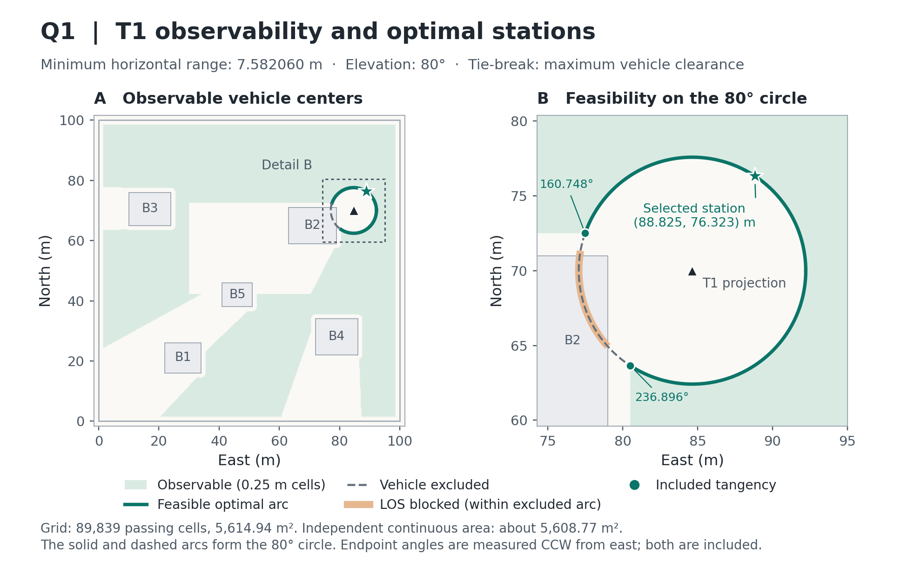

# B 题第一问｜可观测区域与最优观测站

T1 的连续可观测面积约为 **5608.77 m²**。推荐车心坐标为 **$(88.825410107,\ 76.322854075)$ m**，水平距离 **7.582060170464 m**，仰角 **80°**，观测质量 **$0.131890274875\ \mathrm{m}^{-1}$**。达到同一质量的站位构成一条连续圆弧，推荐点在弧上使最小车体净空最大。 [结果归档](../results/q1/可观测区域与最优站位_连续圆弧_20261120/summary.json) · [原题第 1–3 页](../problem/B/2026_“ShuWei%20Cup”B_Problem.pdf)

## 可观测区域的三个判据

以场地西南角为原点，正东、正北分别是 $x,y$ 轴，调度中心 $O=(50,50)$。将告警 $(\theta,R,H)=(30^\circ,40,45)$ 转成目标坐标 $T_1=(50+40\cos30^\circ,70,45)$，记水平投影为 $T_1'$。车心 $P=(x,y)$ 的相机位置为 $C=(x,y,2)$，车体半径 $\rho=1.5$ m。设 $F_j$ 为第 $j$ 栋楼的底面闭矩形，$h_j$ 为题定楼高。 [场地配置](../results/q1/可观测区域与最优站位_连续圆弧_20261120/config.yaml)

1. **车体可停车。** $P\in[1.5,98.5]^2$，并且 $d(P,F_j)\ge\rho$ 对五栋楼均成立。点到矩形的距离按两轴各自超出矩形坐标范围的距离取平方和开根。等价地，场界内缩 $\rho$，楼底按半径 $\rho$ 的圆盘外扩，扣掉外扩区域的内部。楼角的外扩是圆弧。题面允许车体与边界相切，只禁止越界和进入楼体内部。
2. **云台俯仰可达。** 设 $r=\|P-T_1'\|$，仰角为 $\beta=\operatorname{atan2}(43,r)$。题设仰角范围为闭区间 $[-10^\circ,80^\circ]$。对高于相机的 T1，这一条件等价于 $r\ge r_0=43\cot80^\circ$。
3. **视线无楼体遮挡。** 对每栋闭长方体 $F_j\times[0,h_j]$，将视线写成 $C+t(T_1-C)$，$0\le t\le 1$。将三个坐标分别代入该楼的闭区间，得到三个 $t$ 区间。它们与 $[0,1]$ 的交集一旦非空，便判为遮挡。线段平行于某个坐标平面时用该坐标的常数值判断。交集只有一个点也算遮挡。

三条件同时成立的 $P$ 构成可观测区域 $\mathcal V_1$。绘图时按单元中心判定三张掩码再取交，主图网格间距为 $0.25$ m。连续面积使用另一种算法。由于五栋楼的高度均介于 2 m 与 45 m 之间，楼体在相机高度平面的遮挡集合为 $F_j$ 与以 $T_1'$ 为中心、倍率 $43/(45-h_j)$ 的楼底投影的凸包。倍率由视线到达屋顶标高时的参数 $t=(h_j-2)/43$ 得到。取遮挡凸包、车辆禁入区和仰角禁入圆的并集，从内缩场地中扣除，用竖条截面的上下包络夹住面积。 [独立连续面积复核](../results/q1/可观测区域与最优站位_连续圆弧_20261120/area_check_continuous.md)

## 最优值、全部取等站点与同分择优

主目标为

$$
\max_{P\in\mathcal V_1} Q(P)=\max_{P\in\mathcal V_1}\frac{1}{\|P-T_1'\|}.
$$

仰角条件给出 $Q\le 1/r_0$。正东见证点 $P_E=T_1'+(r_0,0)$ 落在可停车区域，五栋楼均不遮挡，且仰角取 80°。因此上界可达，所有取等点都在 $P(\phi)=T_1'+r_0(\cos\phi,\sin\phi)$ 上。$\phi$ 从正东逆时针量起，独立于原告警相对调度中心的方位 $\theta$。 [见证点与逐栋复核](../results/q1/可观测区域与最优站位_连续圆弧_20261120/summary.json)

最优圆完全位于内缩场界内，仅与 B2 的车辆禁入区相交。由 B2 北侧的 $y=71+1.5$ 与东侧的 $x=79+1.5$ 得到相切分界。两个切点分别位于北边、东边的直线段上。圆与 B2 视线遮挡的角段约为 $[169.947439^\circ,221.927136^\circ]$，整个落在车体禁入弧内。故完整取等角域为

$$
[0^\circ,160.747873328^\circ]\ \cup\ [236.896046854^\circ,360^\circ).
$$

两处切点按题设车辆几何判据保留，$360^\circ$ 与 $0^\circ$ 重合。若要求停车时具有严格正净空，去掉两个切点后仍有整段弧可达到同一最优值。 [弧端点底表](../results/q1/可观测区域与最优站位_连续圆弧_20261120/optimal_arcs.csv)

在这条弧上，用 $c(P)=\min\{x,y,100-x,100-y,d(P,F_1),\ldots,d(P,F_5)\}-\rho$ 度量车辆最小净空，择 $c(P)$ 最大的站点。若净空在浮点余量内仍相同，依次取较小的 $x$、$y$。推荐点的两项限制同时取等，一项来自场地东界，另一项来自 B2 东北角。在该点附近对应方程为 $100-x=\sqrt{(x-79)^2+(y-71)^2}$，结合最优圆方程即可复算坐标。代码用该解析比较与弧上的分支定界核对全域。$c(P)$ 对平面位移是 1-Lipschitz 函数，所以弧段中点的净空加最大弧长可作该段上界。归档上界与所选净空的差约为 $9.15\times10^{-13}$ m。 [取等站和净空证书](../results/q1/可观测区域与最优站位_连续圆弧_20261120/summary.json)

## 正式作答结果与图表

| 项目 | 结果 |
| --- | --- |
| 最优水平距离、仰角 | $7.582060170464$ m，$80^\circ$ |
| 观测质量最优值 | $0.131890274875\ \mathrm{m}^{-1}$ |
| 推荐站位 | $(88.825410107,76.322854075)$ m，圆周角约 $56.503855631^\circ$ |
| 推荐站最小车体净空 | $9.6745898929$ m |
| 连续可观测面积包围 | $[5608.767083,5608.774146]\ \mathrm{m}^2$ |
| 绘图网格复算 | $0.5$、$0.25$、$0.125$ m 三档分别为 $5608.0000$、$5614.9375$、$5607.9375\ \mathrm{m}^2$ |

临界站的坐标供展示。按圆周参数式或归档全精度值复核仰角，保留原有的边界可行性。连续面积建议写为 $5608.77\ \mathrm{m}^2$ 并附包围区间，0.25 m 网格的 89,839 个单元用于绘图。 [代表站底表](../results/q1/可观测区域与最优站位_连续圆弧_20261120/station_table.csv) · [三档网格底表](../results/q1/可观测区域与最优站位_连续圆弧_20261120/region_counts.csv)



[论文矢量图 PDF](../results/q1/可观测域与最优弧_青绿矢量图集_20261121/q1_observability.pdf) · [SVG](../results/q1/可观测域与最优弧_青绿矢量图集_20261121/q1_observability.svg) · [三个约束的独立掩码](../results/q1/可观测区域与最优站位_连续圆弧_20261120/constraint_masks.png)

## 实现与验收

`geometry.py` 实现车体、仰角和视线判定，`region.py` 用 NumPy 生成三张掩码，`optimize.py` 解析最优圆和切点，并以两种角步长复算弧端点。独立验收对代表站用有理数复核线段与闭楼体的交集及圆盘净空。另用二维投影约束规划从 49 个起点求解，再求同分最大净空，结果与推荐站位一致。 [几何实现](../src/q1/geometry.py) · [网格](../src/q1/region.py) · [站位求解](../src/q1/optimize.py) · [独立面积代码](../checks/q1_area.py) · [二维模型对照](../results/q1/可观测区域与最优站位_连续圆弧_20261120/model_comparison_projected_nlp.md)

在仓库根目录按归档配置运行，命令打印新建的 `runs/q1/` 子目录。连续面积复核在该运行目录上执行，完整步骤及输入指纹见运行记录。 [运行记录](../results/q1/可观测区域与最优站位_连续圆弧_20261120/run_record.md)

```bash
nohup env MPLBACKEND=Agg python3 -B -m src.run q1 --profile full \
  --config results/q1/可观测区域与最优站位_连续圆弧_20261120/config.yaml
```

## 参数敏感性：重新选站与固定原站

三档网格只检验离散化误差。本次以标称配置为基线，分别改变仰角上限、T1 的三个坐标、B2 楼高和额外停车净空，共复算 16 个单因素情景。各情景都能达到 $r^*=(H-h_c)\cot\beta_{\max}$；据此比较 $Q^*$，并另算连续可观测面积、最大最小净空站位及原站是否仍可行。

- 仰角上限由 **80° 收紧到 79°**，最优距离由 **7.5821 m** 增至 **8.3584 m**，$Q^*$ 下降 **9.29%**，最优净空站移动约 **1.120 m**。
- T1 向东或向北移 0.5 m，重选后仍能达到原 $Q^*$，但原站仰角超限。16 个扰动中固定原站共有 **6 个**不通过，全部因为仰角超限，车体和 LOS 仍通过。
- B2 加高 1 m 或额外停车净空提高到 0.45 m，面积分别减少 **2.70%**、**3.47%**，而最优质量与推荐站位均不变。后者的面积约 **5414.20 m²**，仍可使用原站。

以上仅对试算幅度和最大最小净空选站规则成立，不替换原题标称结果。 [分析与图](../results/q1/仰角目标位置与净空敏感性_20261122/conclusions.md) · [底表](../results/q1/仰角目标位置与净空敏感性_20261122/sensitivity.csv) · [复跑与验收](../results/q1/仰角目标位置与净空敏感性_20261122/run_record.md)
