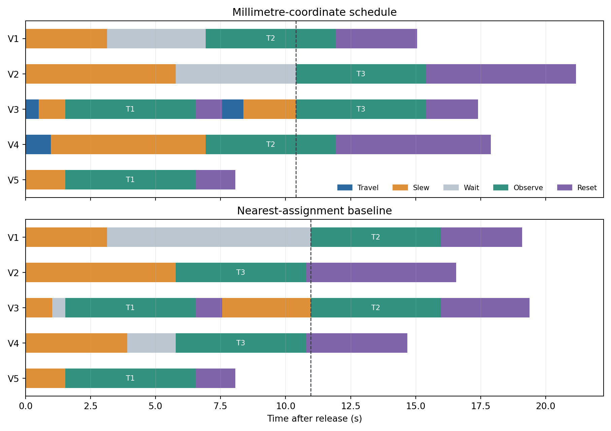

# B 题第二问｜双站定位与多车并发调度

2（1）给出一阶定位精度的理论最优值和按毫米路点验收的双站部署。2（2）的复用车是 V3，先与 V5 观测 T1，再转场与 V2 观测 T3。V1、V4 并行执行 T2。第四问以这套毫米排程 `practical` 为初排。 [原题第 4 页](../problem/B/2026_“ShuWei%20Cup”B_Problem.pdf#page=4) · [毫米方案归档](../results/q2/毫米部署与初排_全程净空四十五厘米_20261121/conclusions.md) · [第四问](B题第四问_扰动重调度与方案对比.md)

## 2（1）方位交会的精度模型

告警给定 T2 的高度 $35$ m，水平投影为 $T_2'=(50+45\cos150^\circ,72.5)$。设两站车心为 $P_1,P_2$，站距 $r_i=\|T_2'-P_i\|$，真方位为 $\alpha_i$，交会角为 $\gamma\in[0^\circ,180^\circ]$。两车同步测得方位后求两条水平视线的交点，仅估计目标的两个水平坐标。两站的方位误差独立服从 $N(0,(1^\circ)^2)$，一阶传播使用弧度制标准差 $\sigma=\pi/180$。

由 $\operatorname{atan2}$ 的梯度，方位变化与水平位置变化满足 $\delta\alpha\simeq J\delta T'$。$J$ 第 $i$ 行为 $(-\sin\alpha_i,\cos\alpha_i)/r_i$。当 $\sin\gamma\ne0$ 时可反解，得到一阶误差协方差和定位指标

$$
\begin{aligned}
\Sigma_{T'}&=\sigma^2J^{-1}(J^{-1})^{\mathsf T},\\
E&=\sqrt{\operatorname{tr}\Sigma_{T'}}
  =\frac{\sigma\sqrt{r_1^2+r_2^2}}{|\sin\gamma|}.
\end{aligned}
$$

$E$ 是水平位置误差向量长度的均方根，单位为米，旋转坐标轴后保持不变。基线长 $B=\|P_1-P_2\|$ 通过 $B^2=r_1^2+r_2^2-2r_1r_2\cos\gamma$ 进入指标。交会角逼近 $0^\circ$ 或 $180^\circ$ 时，雅可比变得病态，严格共线无唯一交点。应剔除共线站对，将近共线站对换成较大 $|\sin\gamma|$ 的站对，并用非线性方位交会抽样检查长尾误差和反向交点。可观测域的边界需逐项判断。闭仰角边界可以取等，车体相切按题面几何口径处理，视线接触楼体的点直接排除。 [精度实现](../src/q2/precision.py) · [交会噪声与边界试验底表](../results/q2/双站定位与并发调度_连续站位_20261120/q21_sensitivity.csv)

### 理论取等与毫米部署

相机高 2 m，仰角上限给出 $r_i\ge r_0=33\cot80^\circ=5.818790363$ m。结合 $|\sin\gamma|\le1$，可得 $E\ge\sqrt{2}\sigma r_0$。两站等距且正交时取等。T2 的西、北向构造已有可行见证。在取等圆上旋转这组正交半径，可以改派 V3、V5 以缩短最长行驶时间。V5 从北侧直接到站。其视线在 B3 屋顶标高处要越过北沿，车体同时要满足 $y\ge76+1.5+0.45=77.95$ m。按较严的车体净空约束定位 V5 后，将半径向量旋转 $90^\circ$ 得到 V3 的西北站。两车均可直达，且各自行驶不超过 30 s。 [理论取等见证](../results/q2/双站定位与并发调度_连续站位_20261120/q21_result.json) · [45 cm 构型与路点](../results/q2/毫米部署与初排_全程净空四十五厘米_20261121/q21_result.json)

直接把该 V5 站四舍五入为 $(13.067,77.950)$ m 会把仰角提高到约 $80.000260^\circ$。部署时沿两站各自半径向外移动 $0.10+\sqrt{2}\times0.0005$ m 后取毫米坐标。后一项覆盖两轴舍入的最大位移。用舍入后的坐标重新求路、计算交会和仰角，再逐线段验收。 [舍入反例](../research/B题第二至四问_优化版约束复核_20261121.md) · [实际路点](../results/q2/毫米部署与初排_全程净空四十五厘米_20261121/q21_practical.json)

### 正式双站结果

| 方案 | 车 | 站点坐标 (m) | 直达路长 (m) | 行驶 (s) | 仰角 (°) |
| --- | --- | --- | ---: | ---: | ---: |
| 全精度取等构型 | V3 | (5.578856630, 74.538582624) | 14.222508 | 4.740836 | 80.000000 |
| 全精度取等构型 | V5 | (13.067439453, 77.950000200) | 39.881280 | 13.293760 | 80.000000 |
| 毫米部署 | V3 | (5.485, 74.574) | 14.249867 | 4.749956 | 79.831167 |
| 毫米部署 | V5 | (13.103, 78.044) | 39.812944 | 13.270981 | 79.830857 |

理论基线长 **8.229012248 m**，交会角 **90°**，达到一阶 RMSE 最小值 **0.143623358 m**。毫米部署的基线长 **8.371070660 m**、交会角 **90.000812°**，一阶 RMSE 为 **0.146101709 m**，增加约 **2.48 mm**。毫米方案的最小楼体、场界净空分别为 **0.544 m**、**3.985 m**，最小连续车心距为 **8.371071 m**。表中的全精度坐标是展示值，执行用 `q21_practical.json` 的精确毫米路点。 [逐车对照](../results/q2/毫米部署与初排_全程净空四十五厘米_20261121/q21_travel_comparison.csv) · [双站几何图](../results/q2/毫米部署与初排_全程净空四十五厘米_20261121/q21_stations.pdf)

## 2（2）把车辆复用写进联合开测时间

三个告警各占两席，共六个席位，至少一辆车需要复用。每条告警选两辆不同的车、两个可达可见站，排除双站圆盘重叠和共线。令 $L_{va}$ 为车 $v$ 上一站到告警 $a$ 分配站的避障路长，$D_{va}$ 为出发时刻。车速恒为 $3$ m/s。到站后从正东水平姿态对准目标，水平转角用回绕后的最短转角。两轴同时转动，指向用时 $\tau_{va}=\max(|\operatorname{wrap}_{180}(\alpha_{va})|,|\beta_{va}|)/30$，式中角度用度。安排给同一告警的两辆车的到站、就绪和开始时间分别满足

$$
A_{va}=D_{va}+L_{va}/3,\qquad U_{va}=A_{va}+\tau_{va},\qquad
S_a=\max_{v\text{ 执行 }a} U_{va}.
$$

较早就绪的车在原地等待。两车从 $S_a$ 起联合观测 5 s，随后各自复位，复位用时等于各自的 $\tau_{va}$。首车次从 0 s 出发。复用车的下一次出发时刻为上一任务的 $S_a+5+\tau_{va}$。优化目标是最小化 $\max(S_{T1},S_{T2},S_{T3})$。告警的枚举顺序用于规定共享车辆的先后依赖，不同车上的准备工作仍可并行。

### 路由、分配与连续下界

- **共用路由。** 把场界内缩、楼底外扩，规划半径取 $1.5+0.45=1.95$ m。用圆盘的外切多边形保守外包障碍，通过可见性图找折线。两点可直达时走直线。最终验收用原楼底几何核查全路段和停车点的净空。两车按各自折线匀速移动时，在每对重叠相位内最小化相对位移的平方距离，同时检查相位端点，要求车心距至少 3 m。 [路由实现](../src/q2/paths.py) · [独立几何检查](../checks/q2_geometry.py)
- **连续细化。** 有限候选站上枚举告警依赖和车对，用已有最晚开测上界剪枝。找到 V3 的 T1→T3 链后，连续优化两个停靠点，压缩这条链的首次就绪时间、5 s 观测后的复位、转场及再次指向。其余三车在该开测上界内补齐分工，并优先选总行程较短的组合。对 `practical` 再增加 0.10 m 的站位余量和预期舍入余量，用实际毫米点复算，六席最小光学支持线余量为 0.100852 m。 [候选搜索](../src/q2/schedule.py) · [连续细化](../src/q2/refinement.py) · [站位余量](../results/q2/毫米部署与初排_全程净空四十五厘米_20261121/q22_station_margins.csv)
- **连续域下界。** 五辆车各执行至多一次只覆盖五个席位，任何可行方案至少含一条有序的复用链。对五辆车和六种前后告警组合的 30 条链，按站位矩形分割，用欧氏距离松弛避障路长，并对仰角、可见区域及指向用时作保守包围，得到最晚开测的连续域数值下界 **10.352100 s**。全精度可行上界 **10.352118514 s** 与其相差 **18.514 µs**。该夹逼针对连续全精度主目标，毫米约束增加后的结果是经验证的可行上界。 [独立下界说明及数据](../results/q2/等精度快速部署与并发排程_20261121/continuous_bound.json) · [下界复算](../checks/q2_continuous_bound.py)

### 正式初排、五车时序与就近对照

| 告警 | 毫米方案站点 (m) | 同步开测 (s) |
| --- | --- | ---: |
| T1 | V3 (15.033, 87.088)，V5 (50.000, 93.000) | 1.532122 |
| T2 | V1 (15.000, 14.000)，V4 (88.064, 70.901) | 6.927598 |
| T3 | V2 (88.000, 10.000)，V3 (16.824, 88.760) | 10.391510 |

五车时序以秒计。到站即开始指向，指向完成至开测之间为等待，观测结束即开始复位。初始车位已作观测站的车次行驶长度为零。V3 从 $(14,86)$ 直达 T1 站，再由 T1 站直达 T3 站。V4 从 $(88,68)$ 直达 T2 站。分配表和路点文件按 `practical` 取用。 [分配底表](../results/q2/毫米部署与初排_全程净空四十五厘米_20261121/q22_assignments.csv) · [完整折线路点 JSON](../results/q2/毫米部署与初排_全程净空四十五厘米_20261121/q22_routes.json)

| 车辆 | 告警 | 出发 | 到站 | 指向完成 | 观测开始 | 观测结束 | 复位完成 | 后续出发 |
| --- | --- | ---: | ---: | ---: | ---: | ---: | ---: | ---: |
| V1 | T2 | 0 | 0 | 3.129448 | 6.927598 | 11.927598 | 15.057046 | — |
| V2 | T3 | 0 | 0 | 5.777589 | 10.391510 | 15.391510 | 21.169099 | — |
| V3 | T1 | 0 | 0.500093 | 1.532122 | 1.532122 | 6.532122 | 7.564152 | 7.564152 |
| V3 | T3 | 7.564152 | 8.380871 | 10.391510 | 10.391510 | 15.391510 | 17.402149 | — |
| V4 | T2 | 0 | 0.967235 | 6.927598 | 6.927598 | 11.927598 | 17.887962 | — |
| V5 | T1 | 0 | 0 | 1.532033 | 1.532122 | 6.532122 | 8.064155 | — |

[逐车时间轴 CSV](../results/q2/毫米部署与初排_全程净空四十五厘米_20261121/q22_timeline.csv) · [毫米方案与就近基线的路线图](../results/q2/毫米部署与初排_全程净空四十五厘米_20261121/q22_routes.pdf)

就近基线对每条告警从相同场地条件下的候选站选合法车对，先比两车从当前站出发的避障总路长，同长时比共同就绪时刻。枚举六种处理顺序，验证各自的完整时序，取最快的 T1、T2、T3 顺序。其分配为 T1 用 V3、V5，T2 用 V1、V3，T3 用 V2、V4，全部原地转向。V3 从 T1 复位后接续 T2，二次指向用时约 **3.414 s**。毫米方案改让 V3 接续 T3，其转场加二次指向约 **2.827 s**，同时由 V1、V4 并行准备 T2。最晚开测提前 **0.577475 s（5.26%）**。 [六序就近对照](../results/q2/毫米部署与初排_全程净空四十五厘米_20261121/q22_greedy_orders.csv)

| 方案 | 最晚开测 (s) | 总行程 (m) |
| --- | ---: | ---: |
| 六序就近 `greedy` | 10.968984244 | 0.000000 |
| 全精度细化 `optimized` | 10.352118514 | 6.638806 |
| 正式毫米初排 `practical` | 10.391509640 | 6.852140 |

[最晚开测与行程底表](../results/q2/毫米部署与初排_全程净空四十五厘米_20261121/q22_refinement.csv) · [时间轴矢量图](../results/q2/毫米部署与初排_全程净空四十五厘米_20261121/q22_timeline.pdf)

## 验收与复跑

独立入口由路点和时间轴重算沿途几何、双站三维视线、角度、云台各相位和连续车距。毫米初排的最小楼体净空为 **5.780110 m**，最小场界净空为 **5.500 m**，最小连续车心距为 **33.445845 m**。两小题的毫米方案都满足附加的 **0.45 m** 全程标称车体净空。实际执行要把跟踪、地图、车体和停车偏差计入同一预算。现场若证实合成全程偏差上界为 0.40 m，按共同 0.45 m 阈值仍有至少约 0.05 m 实际墙距。 [独立验收结果](../results/q2/毫米部署与初排_全程净空四十五厘米_20261121/independent_validation.json) · [逐路线净空](../results/q2/毫米部署与初排_全程净空四十五厘米_20261121/wall_clearance.csv) · [复跑与验收命令](../results/q2/毫米部署与初排_全程净空四十五厘米_20261121/run_record.md)
