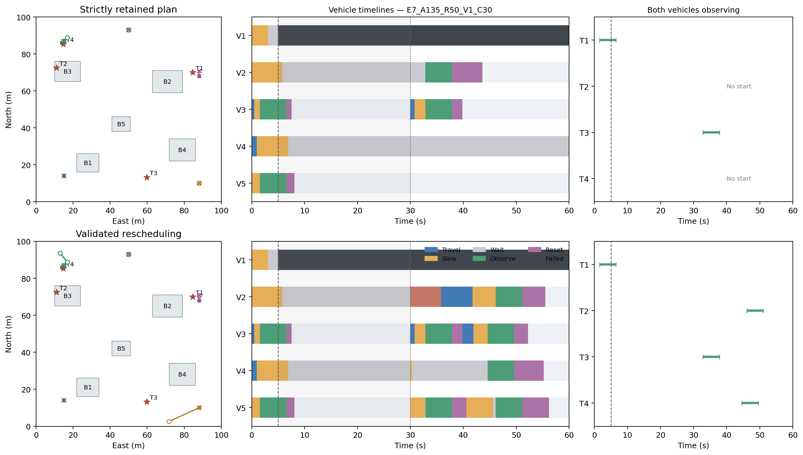

# B 题第四问｜扰动重调度与方案对比

所有策略从第二问 2（2）的毫米排程 `practical` 起步。重调以新命令可下发时的车辆状态为起点，为尚未开测的告警决定分车、站位和车次。评分按题设的成功开测比例及最晚开测时刻，另报告是否采满连续 5 s 双车数据。 [原题第 5 页](../problem/B/2026_“ShuWei%20Cup”B_Problem.pdf#page=5) · [第二问毫米初排](B题第二问_双站定位与多车并发调度.md)

## 场景设计与计分规则

扰动在 **5 s** 发生。新增 T4 采用方位 $0^\circ,15^\circ,\ldots,345^\circ$、水平距离 $30,40,50$ m，高度固定 50 m。全方位覆盖场地各方向，径向取两端与中点。单车故障遍历 V1 至 V5，条件故障概率各为 $1/5$。恢复时刻在绝对时间上满足 $t_{\rm rec}\in(5,30]$ s，取 $10,20,30$ s，覆盖停联 $5,15,25$ s。七类扰动的组合规模分别见下文结果表。场景均值对样本等权，只用于比较同一场景清单上的策略。 [命题人关于恢复时刻的答疑](https://pd.qq.com/g/pd52619943/post/B_e4b7ff6a0ac20e001441152187121863520X60?subc=745397906) · [场景清单](../results/q4/毫米初排与联合断联限制_全程净空四十五厘米_20261121/scenario_manifest.csv)

评估窗为 $[0,60]$ s。$N$ 表示当场总告警数，无 T4 时为 3，有 T4 时为 4。$S_a$ 为两辆合法搭档都完成指向后同步开测的时刻。记 $k=\#\{a:S_a<60\}$，有

$$
\eta=k/N,\qquad
t_{\rm last}=\begin{cases}
\max_a S_a & k=N,\\
60\ \mathrm{s} & k<N.
\end{cases}
$$

先最大化 $\eta$，再最小化 $t_{\rm last}$。实采长度取两车 `OBSERVING` 相位的交集与评价窗相交后，对应同一告警实际连续双车采集的秒数。比较是否达到 5 s，场景内采满的告警数记为 `k_full_observation`。已开测后被故障中断的告警保留其 $S_a$ 和计分资格。 [计分与实采实现](../src/q4/report.py)

## 断联前缀与恢复后的重调

### 可执行的车辆状态

0 s 只下发第二问毫米初排，告警变化、故障车编号和恢复时刻均从实际事件获得。无断联时，在 5 s 观察到事件即重调。有断联时，新命令最早在 $t_{\rm rec}$ 生效。先根据已有命令和本工况的断联规则回放各车在此之前的行驶、指向、等待、观测及复位。以弧长插值截取途中车位，以两轴转速截取云台姿态。快照保存车位、姿态、相位、剩余路点、当前告警和车辆释放时刻。

故障车在 5 s 退出，按题设从可调车辆与行车障碍中移除。未开始联合观测时若搭档故障，正常车按仍有效的原命令到站等待，待通信可用后再接受替补或改派。告警在重调生效之前已开测即锁定，包括允许在断联期合法开测的任务。健康搭档在完成已锁定的观测占用和复位后才能接新任务。恢复与发车或同步开测同刻时，先读取实际状态，再确认或发令。 [前缀与快照实现](../src/q4/physics.py)

题面规定继续执行进行中的任务。旧队列能否继续发起后续车次、原搭档能否在中心断联时互相确认就绪，是两项单独建模的条件。

| 执行口径 | 断联期可启动旧队列的后续车次 | 断联期可确认并新开联合观测 |
| --- | --- | --- |
| 主规则 `main` | 可以，0 s 已完整预授权 | 可以，假定原搭档仍有就绪确认通道 |
| 只续当前车次 `current_trip_only` | 暂缓至恢复 | 可以，由已开始执行该车次的搭档确认 |
| 恢复后确认 `confirm_after_recovery` | 可以，依照完整旧队列 | 暂缓至恢复 |
| 两条限制同时生效 `strict_outage` | 暂缓至恢复 | 暂缓至恢复 |

只续当前车次时，车辆继续执行 5 s 前已开始的车次，复位后在原站等待通信恢复。四种口径均保留未受故障影响的既有观测与复位。每种口径重新生成实际前缀与原调度基线，再用同一初排、同一场景和同一快照配对比较。 [建模口径](decisions.md#2026-11-21毫米初排两条断联限制与实际采集) · [实验配置](../results/q4/毫米初排与联合断联限制_全程净空四十五厘米_20261121/recourse_config.yaml)

### 搜索与连续轨迹验收

重调的决策变量是每条未锁定告警的两辆健康车辆、两站位置及共享车辆的车次顺序。设车 $v$ 的释放时刻为 $f_v$，当前点为 $p_v$，可用姿态为 $g_v$，所选站为 $P_{va}$，预计从释放到就绪需 $b_{va}$ 秒。若在原地换目标，$b_{va}$ 为当前姿态到目标姿态的双轴指向时间。若需离站，$b_{va}$ 为转回正东水平的时间、从实时车位起算的避障路长除以 3、到站后的指向时间之和。行驶中维持原目的站时沿剩余折线接续。对两辆所选车辆 $u,v$，有

$$
S_a=\max(f_u+b_{ua},f_v+b_{va}),\qquad
f_w^{\rm new}=S_a+5+\tau_{wa}^{\rm reset}\quad(w\in\{u,v\}).
$$

候选站包括原站、初始车位、本场快照点、近站矩形网格及目标的补充站集。用第二问的可见性图路由，同一几何检验筛掉仰角越界、闭楼体遮挡、站间距不足 3 m 或距共线不足 5° 的站对。行驶及停车附加的标称车体墙距为 0.45 m。毫米限制用于初排，恢复后的路点按归档全精度回放。 [候选生成](../src/q4/candidates.py) · [就绪预测与束搜索](../src/q4/recourse.py)

束搜索从快照出发，每层尝试给一条待处理告警选车对与站对，记录各车末站和释放时刻。近站矩形按每轴 4 点采样。全场搜索先取每车最早就绪的 8 站，由两车共同就绪时间筛站对，分别用每车对保留 2 个与 8 个站对的设置搜索。短名单无可行站对时回查全名单。每层至多扩展保留下来的 36 个状态，选前 8 个交给回放。换站重调保留固定旧站的候选作为后备。 [搜索实现](../src/q4/recourse.py) · [实验配置](../results/q4/毫米初排与联合断联限制_全程净空四十五厘米_20261121/recourse_config.yaml)

候选按开测数及最晚开测排序。回放重算时间、姿态、墙距及连续车距，取排序中首个通过验收的方案。结果是有限候选集上求得的可行方案，所报开测时刻按求解与新指令传输延迟为 0 s 计算。 [搜索与归档入口](../src/q4/recourse_experiment.py) · [独立回放](../checks/q4_replay.py)

### 被比较的策略

| 策略 | 允许的动作 |
| --- | --- |
| 严格冻结 `strict_frozen` | 依照有效的旧分车、旧站和旧路线继续，受故障影响的未开测任务无替补，无 T4 车次 |
| 保留并追加 `original_append` | 保留旧告警的执行，利用剩余可释放车辆无干扰地为 T4 追加车次 |
| 固定旧站重调 `fixed_stations` | 可替换未开测告警的车辆、调整先后，旧告警沿用初排的两个站 |
| 换站重调 `recourse` | 同时重选未开测任务的车辆、站位与次序 |
| 推荐 `recommended` | 从上述经回放验收的策略按题设评分选优，评分并列时比较开测时刻之和及改动代价 |

## 正式作答结果

### 1,751 个主场景的同场比较

| 策略 | 全部开测的场数 | 平均 $\eta$ | 平均最晚开测 (s) | 全部采满 5 s 的场数 |
| --- | ---: | ---: | ---: | ---: |
| 严格冻结 | 7 | 58.576% | 59.801679 | 3 |
| 保留并追加 | 583 | 83.248% | 47.835285 | 291 |
| 固定旧站重调 | 1,751 | 100% | 34.309816 | 1,021 |
| 换站重调、推荐 | **1,751** | **100%** | **24.745782** | **1,167** |

主场景中，推荐方案最迟一场在 **40.330420 s** 全启，固定旧站重调最迟为 **57.499284 s**。按扰动类型比较时，未全启的场按 60 s 计入平均。 [策略汇总](../results/q4/毫米初排与联合断联限制_全程净空四十五厘米_20261121/protocol_summary.csv) · [对比图](../results/q4/毫米初排与联合断联限制_全程净空四十五厘米_20261121/recourse_comparison.pdf)

| 类别 | 样本数 | 保留并追加全启数 | 保留并追加平均 (s) | 推荐全启数 | 推荐平均 (s) |
| --- | ---: | ---: | ---: | ---: | ---: |
| E1 新告警 | 72 | 72 | 18.408 | 72 | 16.334 |
| E2 单车故障 | 5 | 1 | 50.078 | 5 | 10.840 |
| E3 断联 | 3 | 3 | 10.392 | 3 | 10.392 |
| E4 新告警＋故障 | 360 | 72 | 52.061 | 360 | 20.452 |
| E5 新告警＋断联 | 216 | 216 | 24.605 | 216 | 24.033 |
| E6 故障＋断联 | 15 | 3 | 50.078 | 15 | 20.233 |
| E7 三类同时发生 | 1,080 | 216 | 53.097 | 1,080 | 27.047 |

[各扰动类别和规则的汇总底表](../results/q4/毫米初排与联合断联限制_全程净空四十五厘米_20261121/category_summary.csv)

### 四种规则共用的 1,314 个含断联场景

| 通信规则 | 推荐全启场数 | 全部采满 5 s 的场数 | 平均最晚开测 (s) | 最差最晚开测 (s) |
| --- | ---: | ---: | ---: | ---: |
| 主规则 | 1,314 | 876 | 26.436092 | 40.330420 |
| 只续当前车次 | 1,314 | 876 | 28.230258 | 46.108009 |
| 恢复后确认 | 1,314 | 876 | 31.725858 | 46.108009 |
| 两条限制同时生效 | **1,314** | **876** | **32.300690** | **46.108009** |

在这批同场对照中，将就绪确认推迟到恢复后，平均最晚开测增加 **5.290 s**。单独限制后续车次，增加 **1.794 s**。两条同时限制，增加 **5.865 s**，固定旧站、保留并追加、严格冻结分别有 **1,236、438、6** 场全启。推荐方案在其中 **438** 场遇到 V3 或 V5 于 5 s 退出，T1 自 $1.532122$ s 开测后实采 **3.467878 s**。其健康搭档按原占用时间完成该任务并复位。逐告警底表给出计划观测结束、实际双车结束和窗内时长。 [逐场配对](../results/q4/毫米初排与联合断联限制_全程净空四十五厘米_20261121/paired_policies.csv) · [逐告警实采](../results/q4/毫米初排与联合断联限制_全程净空四十五厘米_20261121/alert_results.csv.gz)

### 代表情景和瓶颈

- **换站能替代跨场行驶。** 主规则 `E6_V2_C10` 在 10 s 恢复，V2 故障，T1 和 T2 已锁定。保留并追加只能启动 $2/3$ 条告警。固定旧站重调仍需另一辆车前往 V2 的原 T3 站，T3 最晚到 **43.965896 s** 才开测。换站后由 V3、V5 接手 T3，最晚开测 **12.765521 s**，两条重调方案均全启。 [代表场景表](../results/q4/毫米初排与联合断联限制_全程净空四十五厘米_20261121/representative_cases.csv) · [对照时序](../results/q4/毫米初排与联合断联限制_全程净空四十五厘米_20261121/representative_timeline.pdf)
- **纯断联的收益取决于哪些车次可以继续。** `E3_C30` 在主规则下三任务均于恢复前开测，10.391510 s 全启，沿原计划即可。两条限制同时生效时，V3 在 **7.564152 s** 复位后停车，V1、V4 到位并对准后等待。30 s 先处理恢复再使 T2 同刻开测。推荐用 V2、V5 执行 T3，**32.765521 s** 全启，保留原计划则为 **32.827358 s**，只差约 **0.062 s**。 [恢复快照](../results/q4/毫米初排与联合断联限制_全程净空四十五厘米_20261121/scenario_inputs.jsonl.gz) · [逐车相位](../results/q4/毫米初排与联合断联限制_全程净空四十五厘米_20261121/plans_and_tracks.jsonl.gz)
- **30 s 恢复叠加故障推迟末项。** 联合限制下最迟的 `E7_A135_R50_V1_C30` 同时新增 T4、失去 V1，并于 30 s 恢复。T1 已开测。恢复后用 V3、V5 开始 T3，V3 此后与 V4 于 **44.576906 s** 开始 T4。V2 从等待 T3 的姿态退回正东水平，再行驶至新 T2 站、指向并与 V5 会合，T2 于 **46.108009 s** 开测。若固定旧站，最晚开测为 **59.329212 s**，只有 2 个告警能在 60 s 内采满。 [逐场分数底表](../results/q4/毫米初排与联合断联限制_全程净空四十五厘米_20261121/model_comparison.csv.gz) · [该场时序矢量图](../results/q4/毫米初排与联合断联限制_全程净空四十五厘米_20261121/strict_outage_timeline.pdf)

## 逐场交付与复跑

归档以 `scenario_id`、`variant`、`model` 对齐逐场分数与逐车轨迹。`scenario_inputs.jsonl.gz` 记录恢复快照和站对索引，`plans_and_tracks.jsonl.gz` 的 `picks` 指向分车和站对，`tracks` 保存每车各相位的起止、姿态和折线路点。配合逐告警表可查每场的 $(\eta,t_{\rm last})$、分工、发车、到站、指向、等待、观测及复位时间。 [场景快照与站对](../results/q4/毫米初排与联合断联限制_全程净空四十五厘米_20261121/scenario_inputs.jsonl.gz) · [分相位轨迹](../results/q4/毫米初排与联合断联限制_全程净空四十五厘米_20261121/plans_and_tracks.jsonl.gz)

全量验收覆盖 **5,693** 个场景与规则组合、**28,465** 套策略轨迹和 **113,475** 条告警记录。最小楼体净空 **0.4500002 m**、最小场界净空 **0.4500001 m**、最小连续车心距 **3.241693 m**，覆盖行驶、截断折线及停车。数值结论适用于所列的代表性样本和标称时序。按 0.45 m 的共同墙距下界推算至少约 0.05 m 实际墙距，需要现场证实跟踪、地图、车体与停车的全程合成偏差至多 0.40 m。 [逐场净空](../results/q4/毫米初排与联合断联限制_全程净空四十五厘米_20261121/wall_clearance.csv.gz) · [全量独立验收](../results/q4/毫米初排与联合断联限制_全程净空四十五厘米_20261121/full_run_validation.json) · [归档回放](../results/q4/毫米初排与联合断联限制_全程净空四十五厘米_20261121/archive_validation.json) · [复跑、验收与导出命令](../results/q4/毫米初排与联合断联限制_全程净空四十五厘米_20261121/run_record.md)
