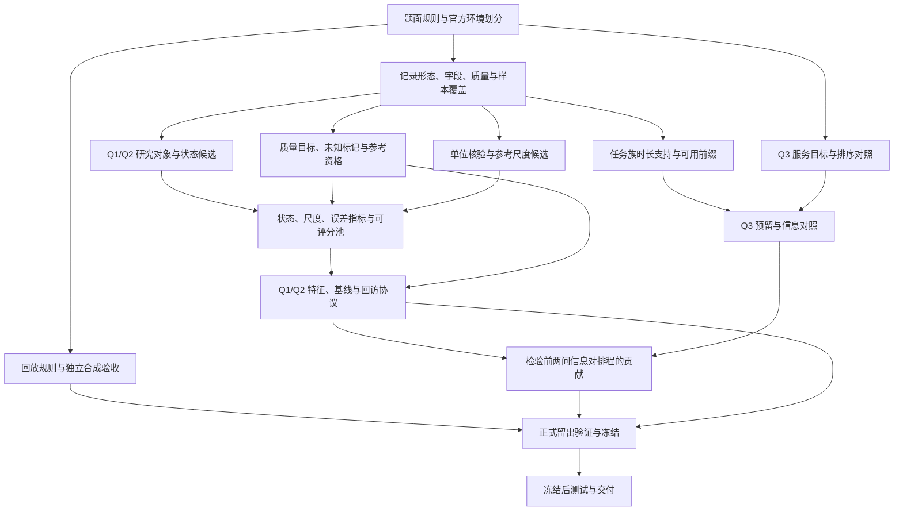

# C 题决策依赖图

先把题面硬约束写到[验收清单](C题验收清单.md)，看训练实物和失败例后发散。每个候选说明它解释什么、最可能在哪类记录失效。每轮记录前置条件，只在能区分候选时运行小实验。队伍在证据足够时签定相应决策，下游才据此冻结接口和开展正式验证。

| 决策 | 本轮状态 | 解除阻塞的证据 |
|---|---|---|
| 原始形态、标签与分组 | 已有数据盘点，进入案头复核 | 打开训练样本图，核对时间轴、关节、动作片段、质量标记；按来源说明缺失与入选分母 |
| 正式状态、尺度与参考池 | 两份源规范均给出位置单位米，0–9 参考长度在 328 个合格训练窗逐手可用；正式选择开放 | 结合任务含义、历史通道是否允许取 9 号点，以及应用要求的厘米或比例容差决定主指标。若更换状态和来源，重数合格窗。[尺度诊断](../research/C题关节映射与无量纲误差核验.md) |
| Q1/Q2 的特征、基线与正式容差 | 已能在共同窗评分腕点、腕姿、四指弯曲和双腕相对位置。质量门控已有恢复首点试验，简单线性与浅树风险已有留环境对照 | 队伍根据操作问题决定正式目标分量、每个包的字段与报价，再定应用容差。保留相同支出的误差比较与分环境覆盖。[可行性复盘](C题正式实现前可行性复盘.md) |
| Q3 目标、排序与预留 | 加权按时完成率优先、加权拖期次之。已有 9 对排序诊断及同协议新增 9 次上四分位预留对照 | 对照提示长预留会影响按时率。正式预留与排序由队伍确定，完整验证保留各臂的分配与事件账本。[预留试跑](../research/C题分位预留可行性探索.md) |
| 调度是否需要额外观测信息 | 依赖可用特征和目标 | 判明何种已披露信息能改变可行的预留、顺序或复核决定，并与不开复核对照 |
| 正式实现与冻结 | 以模块为单位推进 | 某项决定一旦确定，其输入输出、失败回退和验收样例可以进入 `src/`。跨问综合验证依赖共同协议和回放验收 |

每次决定登记研究问题、备选、证据、适用范围和受影响节点。若新证据推翻已有取舍，保留旧图及结果的版本，在新版本重开该节点及其后继。这样每一版依赖图都保持无环，探索可以反复迭代。[讨论记录](modeling-notes.md) · [决定记录](decisions.md)
