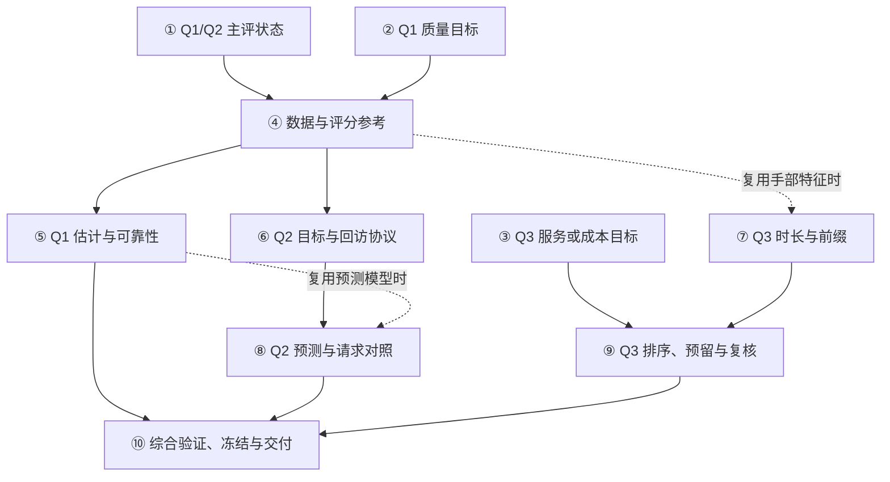

# C 题决策依赖图

## 本轮从哪里开始

队伍已认可按用途保留多种手部表示，研究观测的行动价值，并在 FCFS、EDD 之外优先增补 WSPT。`1L`、0.5 秒回执和“按时率优先、拖期次之”均有探索结果，正式应用口径仍开放。官方环境划分、Q2 信息到达前不可用、Q3 共同回放与计分规程直接沿用。[队伍决定](decisions.md) · [题面验收清单](C题验收清单.md)

②已确认 Q1 的可用性评价口径。①已确认四个分量分别评分、指形在正文单报，主评层级待回看。④可据②整理各分量的参考条件与分母。③调度目标、⑦作业族估时可并行。实线表示确认该项所需的前项，虚线表示选用相应特征或模型时才有依赖。[决定记录](decisions.md)

## 十项确认议程

| 待确认问题 | 依赖 | 本项确认后应能写下什么 |
|---|---|---|
| ① Q1/Q2 主要预测手的哪种运动？ | 可开始 | 给腕点平移、腕部朝向、连续指形、双腕相对量分别定用途，注明主评、补充评分或解释。Q1 中选为预测目标的分量在 Q2 沿用。 |
| ② Q1 如何评价四个分量的可用性？ | 口径已确认 | 按观测条件分别报告独立核验的准确性和采用读数对后续估计的帮助。坏段时间规律单列，提前预警暂作探索。[各分量的证据](#第二项讨论与各分量的参照) |
| ③ Q3 指标冲突时优先保障什么？ | 可开始 | 结合案例说明服务、拖期、成本或产能风险的优先级，约定并列如何处理。若成本或产能风险优先，列出名义条件下逐案例的服务底线。同步保留全部共同指标。 |
| ④ 什么数据能拟合、能评分、能作为在线输入？ | ①② | 逐分量列坐标、单位、参考资格、源时刻、可用时刻、零窗来源与分母。天然坏段与人工遮挡窗按用途取样。若要作抓取或释放的语义结论，先核人工可判率与边界分歧；连续几何可直接用合格骨架。[预处理口径](C题预处理与特征口径.md) · [试读分歧](../research/C题训练视频事件标记试读.md) |
| ⑤ Q1 哪个估计器和质量模型值得保留？ | ④ | 确定少参数基线、可替换候选、未知质量的处理和回退。用任务／环境分组、坏段起点与持续表现、概率校准或状态误差验证增加特征的收益。 |
| ⑥ Q2 用什么约束判断一次回访值不值？ | ④ | 依据应用选择预算约束或精度要求，说明容差、短／长窗、每包字段、报价、等待与返回时钟。形成所有方法共用的一份协议，并写明主要比较量。 |
| ⑦ Q3 凭哪些信息估计时长分布？ | 作业族基线可开始；迁入手部特征时用④ | 写明族中位数／分布、稀有族的支持、免费与两档付费前缀的特征。在相同片段比时长误差、区间覆盖与宽度。已有 246 个训练与 35 个验证片段。[前缀证据](../research/C题腕部前缀岭回归验证.md) |
| ⑧ Q2 哪种预测、请求与回执更新方式有增量？ | ⑥；可复用⑤ | 固定请求比预测器，再固定预测器比请求。以不回访、固定时机及同实际支出随机作参照，用留环境结果检验熵、恢复时间、预计误差收益各自的贡献。[同支出证据](../research/C题双腕回执信息与选窗上限.md) |
| ⑨ Q3 怎样区分派工、预留与复核的贡献？ | ③⑦ | 固定其他模块比较 FCFS、EDD、WSPT，按目标考虑最小松弛时间或前瞻。另做预留配对，以及零复核、同安排付费使用／忽略回执的对照。按 Q3 的规则计入费用与设备占用，各臂保存事件账本。[预留试跑](../research/C题分位预留可行性探索.md) |
| ⑩ 哪些比较足以支撑最终结论？ | ⑤⑧⑨ 汇合 | 正式比较前登记主要指标、信息边界、分组与敏感性，各问就绪后可分别做官方验证。Q3 每方法 3 案例 × 5 映射 × 30 公开种子。报告配对波动、最差环境或案例及失败机制。验证选定后冻结，再用测试集评估，并披露前期描述性质检。[验收清单](C题验收清单.md) |

## 第一项讨论与可并行的试验

①先决定论文主要想解释哪种运动差异。建议逐手腕位、腕向作为主评，连续指弯单列评分，双腕相对向量用于解释协同。如果重视手指操作，可把指形与腕位、腕向并列主评，要求主要结论同时交代三类误差；如果最关心两手配合，可把相对运动放在首位，单腕平移与朝向用于分解。以上分量已在同一批 328 个训练长窗上评分。扩读腕姿字段使回执到达后的腕角平均误差下降约 17–18°，指弯仍有逐窗退化，扩包报价尚待确定。第一项先定预测对象，正式回访通道、费用及容差留到⑥。[共同窗与各分量反例](../research/C题腕姿指形回访可行性探索.md)

并行时，②可直接核对现有起点／恢复的分母，③可用 S1–S3 的指标冲突案例解释业务后果，⑦可查已有族时长和稀有族支持。若考虑将语义动作纳入主评，可同时在训练视频上做队员复标，依据可判率决定是否扩标。既有 FCFS/EDD 的 9 对名义结果直接复用存档。

**① 的当前进度。** 队伍认可四类量分别评分，指形应充分考虑。腕位与腕向同时改善、指弯却退化的训练窗为左手 88/328、右手 65/328。另在同池中直接比较“已读本手腕部，再读指弯”的条件信息，分别评价窗末指形与腕点目标。新操作的语义识别仍需物体和边界参照。正式主评仍开放。[同窗对照详表](../research/C题腕姿指形回访可行性探索.md) · [指形的条件增量](../research/C题腕姿手型与相对位置候选核对.md)

指形的阈值、PCA、聚类与条件互信息对照已归入[探索记录](modeling-notes.md)。指形进入正文，保留退化案例，和腕部误差分开报告。①的主评层级等②梳理完可靠性证据后再议，回访包与费用留到⑥。

## 第二项讨论与各分量的参照

队伍已确认两类证据分别列账。准确性写明独立参照能核验的维度，没有相应参照的维度标「未核实」。使用价值写明采用与跳过同一读数的配对结果、评分时刻、样本分母与预测器。

| 分量 | 准确性的独立核验 | 对估计的实际帮助及适用范围 |
|---|---|---|
| 腕位 | 在可匹配画面中核验二维投影一致性。腕位深度与三维物理准确性未核实。 | 65 个完整自然坏段、130 个逐手恢复首点。同一保持预测器采用腕点读数或整段跳过，同源恢复首点误差分别为 1.57、6.25 厘米。[恢复首点对照](../research/C题质量门控可行性探索.md) |
| 腕向 | 物理朝向准确性未核实。四元数合法是数值检查，同源掌面法向只描述部分旋转。 | 显式正常轨迹的人工长窗已有腕角对照。天然坏段中使用腕向读数对恢复首点估计的帮助待分量配对核验。[腕角对照](../research/C题腕姿指形回访可行性探索.md) |
| 指形 | 物理指弯角准确性未核实。视频可核手指是否可见，同源骨架能算出角度。 | 人工长窗已报告读入指形字段后的逐指误差和退化窗。天然坏段中使用指形的帮助待按手、按指配对核验。[指形对照](../research/C题腕姿指形回访可行性探索.md) |
| 双腕相对运动 | 两腕间三维相对向量的物理准确性未核实。手别、时钟与双手同时可见是参考条件。 | 人工长窗中已对照双腕位置包对相对向量估计的影响。天然坏段需另列两腕同时可评分的分母与对照结果。[相对向量对照](../research/C题腕姿指形回访可行性探索.md) |

发生、持续、恢复另报。照搬上一标记的训练基线命中 296 个持续坏点，65 个可观察新起点均未命中。提前预警暂作探索。Q1 向 Q2 提供各分量的参考条件、坏段持续与恢复统计；Q2 在此基础上结合误差随时间的变化、回执延迟和费用判断等待价值。[起点与持续的分母](../research/C题质量信息与起点预警训练诊断.md) · [恢复时间](../research/C题持续超差时长与遮挡条件持续率.md)

## 已有证据索引

| 决策 | 本轮状态 | 接下来用到的证据 |
|---|---|---|
| 原始形态、标签与分组 | 已完成三来源盘点、全量视频描述性质检与训练短片的 AI 试读 | 按正式状态重数参考池，并为确实采用的语义事件补队员复标。[数据审计](../research/C题全量多模态数据复核.md) |
| 正式状态、尺度与参考池 | 两份源规范均给出位置单位米，0–9 参考长度在 328 个合格训练窗逐手可用；正式选择开放 | 结合任务含义、历史通道是否允许取 9 号点，以及应用要求的厘米或比例容差决定主指标。若更换状态和来源，重数合格窗。[尺度诊断](../research/C题关节映射与无量纲误差核验.md) |
| Q1/Q2 的特征、基线与正式容差 | 已能在共同窗评分腕点、腕姿、四指弯曲和双腕相对位置。质量门控已有恢复首点试验，简单线性与浅树风险已有留环境对照 | 队伍根据操作问题决定正式目标分量、每个包的字段与报价，再定应用容差。保留相同支出的误差比较与分环境覆盖。[可行性复盘](C题正式实现前可行性复盘.md) |
| Q3 目标、排序与预留 | FCFS、EDD 为已实现基线，队伍认可优先增补 WSPT，关注交期时再比较最小松弛时间。现有试跑暂按按时率优先、拖期次之评价 | 依正式目标确定排序及预留，在同一复核安排下检验使用回执的增量。完整验证保留各臂的分配与事件账本。[预留试跑](../research/C题分位预留可行性探索.md) |
| 调度是否需要额外观测信息 | 依赖可用特征和目标 | 判明何种已披露信息能改变可行的预留、顺序或复核决定，并与不开复核对照 |
| 正式实现与冻结 | 以模块为单位推进 | 某项决定一旦确定，其输入输出、失败回退和验收样例可以进入 `src/`。跨问综合验证依赖共同协议和回放验收 |

每次决定登记研究问题、备选、证据、适用范围和受影响节点。若新证据推翻已有取舍，保留旧图及结果的版本，在新版本重开该节点及其后继。这样每一版依赖图都保持无环，探索可以反复迭代。[讨论记录](modeling-notes.md) · [决定记录](decisions.md)
