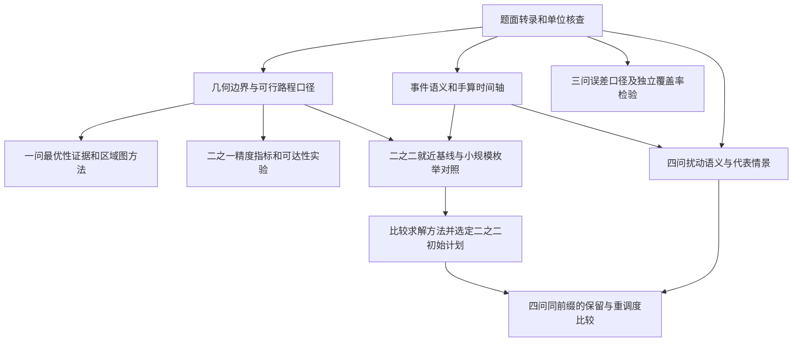

# B 题首轮讨论：哪些证据会改变模型选择？

工作区为 `explore/b-first-round`。已逐页核对英文题面、表 1、图 1 和图 2，并复跑下方输入核查。四问的交付物、原文页码和复核证据集中在[验收清单](b-acceptance.md)。这里的方案供队员比较，模型和项目模块留待讨论。

## 第一次数据核查

当前 `problem/B/` 只有五页英文 PDF。表 1 和正文给出了场景和噪声参数，图 1 是示意图。直接转录数值可避免从图像素反推位置。坐标原点在西南角，正东为 0°，逆时针为正。保存原始角度，调用三角函数时才转弧度，内部坐标保留全精度。[英文原题](<../problem/B/2026_“ShuWei Cup”B_Problem.pdf>) · [参数转录及源文件校验值](../experiments/b/scene.json)

`python3 experiments/b/input_audit.py` 的结果如下。五个车辆初始圆盘均在场内且与建筑内部分离，最小净距为 5.500 m。15 个初始车位与目标的组合中，14 个通过了仰角筛查，完整的可观测判定还需核对视线。

| 告警 | 水平投影（m） | 数据给出的反例或检验点 |
| --- | --- | --- |
| T1 | (84.641016, 70.000000) | V4 到目标投影只有 3.909 m，仰角却达 84.805°，超过 80° 上限。就近基线要先筛可行站，再比较路程。 |
| T2 | (11.028857, 72.500000) | 投影在 B3 内，高度 35 m。V3 的视线进入楼的北侧投影时高度为 26.444 m，且此后继续升高，超过 12 m 楼顶。把投影相交一律判遮挡会误删这条视线。 |
| T3 | (59.835124, 13.294819) | 方位 285° 落在中心东南侧，可查出交换正弦余弦、把正北当零或误用顺时针的录入错误。 |

对 T2 的检查可脱离程序复算。V3 的初始高度为 2 m，视线从地面投影的 `y=86` 走到 `72.5`，在 `y=76` 进入 B3 投影，此时高度为 `2 + (35−2) × (86−76)/(86−72.5) = 26.444… m`。该算例可直接用于以后检验遮挡程序。[核查脚本](../experiments/b/input_audit.py)

## 逐问发散与取舍依据

| 小问 | 可讨论的方法 | 最小的判别实验与决策依据 |
| --- | --- | --- |
| 一：站位可行与质量 | 解析描述约束并采样作图，或用自适应细分描边。平面车辆占地与三维光线分别判定。 | 从仰角上界推水平距离下界，考察对应圆周上是否存在满足全部约束的点。若可取，一个可行点加下界就能说明连续最优，网格只承担画图作用。若不能取，核查楼体接触处是极限还是可行点。 |
| 二（1）：精度 | 水平位置的局部均方根误差（m）、最差方向标准差（m）和误差椭圆面积（m²）各自回答不同问题。后两种可用来检验主指标的排序是否敏感。 | 先在等距离、约直角与近共线的构形上比较，再检验候选下界能否同时满足两站可见、两车各自可达。独立带噪双角检验局部近似，记录病态样本的比例和误差分位数。若下界可达可直接给证据，否则先比较网格加密与连续细化的改进量。 |
| 二（2）：同步调度 | 对有限候选站，用小规模枚举作参考，也可比较分支定界或约束求解。连续站位可做局部改进。 | 在固定小候选集上逐一列出车对和任务顺序，确认手算与程序对同一方案评分一致。再扩大候选集，分别记录改变分配、改变站位带来的收益及耗时。对同一组基线站位固定只改车序，可解释等待损失。只在有对应证明时使用“连续全局最优”。 |
| 三：误差传播 | 一阶传播容易解释方差来源，原始角函数配合数值积分或蒙特卡洛可检验覆盖率。位置分量按米、云台误差按角度处理，最终角差折回规定区间。 | 分别记录由估计位置产生的指令偏差和叠加两项云台误差后的总偏差，注明概率要求采用哪一项。在候选里程两侧检验覆盖率，比较阈值偏移与数值误差。80 m 的交付物是整个非负参数区域。此问可独立开展。 |
| 四：扰动 | 保持原计划、只修补受影响任务、在可传令时重排剩余任务。前两问的几何和时间约束继续有效。 | 先回放无扰动对照，再逐个开启扰动，然后跑组合。两策略共享初始方案与情景，只比较成对差值。只要有任务漏掉，题定最晚开始时间一律为 60 s，此时区分策略主要靠完成数；另列原因和等待时长用于解释。 |

**两个 baseline 要分别命名。** 二（2）要求团队自行定义就近启发式。一种待讨论的可复跑口径是按 T1、T2、T3 顺序追加任务，从车辆已有路线末站到候选站计算可行路程，以两辆不同车辆的新增路程之和择小，要求所选站对能交会。并列时按车号、站号确定。按同一时间轴回放，不共享车辆的任务可并行。可用“更早双车就绪”作敏感性对照，以量化等待代价。四问要求的对照则是保留二（2）选定的原计划，两策略在 5 s 前应有逐车相同的记录。

首个[双车复用算例](q2-baseline.md)使用 T3、固定站位和合成的车辆可出发时刻。枚举全部六种有序分配后，最小新增路程为 6 m，对应共同开始时刻 38.031 s。选择能早释放的车辆时，新增路程 15 m，对应共同开始时刻 27.031 s。详细时间轴给出了两条规则产生不同结果的条件。

**预处理和特征按物理量组织。** 每个原始字段保留来源页和单位。派生量依次对应车站、站对和事件：车站记录场界/楼体净距、仰角余量、首个遮挡楼或可见标志；站对记录水平距离、基线、交会角和病态程度；行程记录绕障路线长度及各段位置；事件记录就绪、等待、复位与可再出发时刻。若缓存距离，键应含实际起终点及场景版本。四问决策只可读当时已知的信息，未来故障身份、恢复时刻和全情景得分仅用于事后分析。新增告警方位和距离只给范围，只有故障车身份有题定的等概率权重。

## 仿真可靠性怎样取得证据

以下是后续程序的独立对账样例。先写下预期值，再让求解器输出计划，让另一段只读检查从路径与原始事件重算可行性和得分。前面的输入核查已运行，下表是待实施的验证设计。

| 对账对象 | 独立依据 | 判定与排错 |
| --- | --- | --- |
| 圆盘与楼角、楼顶视线 | 圆心相对矩形角点向外偏移 `(1.1,1.1) m` 时，到角距离约 `1.556 m`，可容半径 `1.5 m`。水平穿过楼体投影的视线可分别设在楼顶、楼顶上方和楼顶下方。 | 在其余约束均满足的合成场景中，车应可通行，三条光线应分别被挡、通过、被挡。另用上文 V3–T2 核对斜视线。 |
| 双车等待与复用 | 合成两车从 `t=0` 出发，各行驶 2、4 s，指向分别耗 1、2 s。 | 双车在 3、6 s 就绪，第一辆等 3 s，共同观测区间为 `[6,11]`，复位后分别在 12、13 s 可用。用同一张表再验证等待期间不得重复派车。 |
| 角度与概率 | 同时旋转目标和车辆的参考方位，固定 40 m 距离和各向同性位置误差。单独开启各误差源，再开启全部。 | 覆盖率应在数值误差内保持，跨越 ±180° 的微小角差仍应很小。蒙特卡洛记录样本数、种子及二项覆盖率区间；阈值附近区间跨过 0.95 时，增加样本或用独立积分。 |
| 扰动与评分 | 手查同一基线在 5 s 前的事件前缀。给评分器输入四个告警、三个成功开始的人工日志。 | 两策略前缀一致；该日志得 `(3/4, 60 s)`。再测“已开始但未结束”“刚好 5 s”“刚好 60 s”和恢复前试图下新指令。端点规则应能在日志逐行复查。 |

这套检查能检验程序是否实现了题面。论文结论还需注明模型适用的假设，例如目标静止、速度恒定、角误差独立。场景内数值验证与真实设备外场精度需要不同的证据。

## 决策之间的阻塞关系

优先讨论几何判定与事件时间轴。前者决定第一、二、四问哪些站位能用，后者决定第二、四问如何评分。第三问的误差解释可同时讨论。二（2）的车对与站位由自己的开始时间目标决定。四问的情景设计可以先做，正式比较才依赖二（2）的初始计划。

一个节点的讨论记录包括候选项、会使团队改变选择的证据、采用选项和受影响的下游。团队确定的决策按仓库约定记入 `docs/decisions.md`。正式架构可围绕实际出现的复用边界讨论，例如几何判定和时间回放各自能否接受独立检查。正式代码放在 `src/`，论文结果应可从版本化场景、运行命令和事件底表复现。

## 题意核实与实验约定

- 已核实第四问的通信恢复时刻。2026 年 11 月 20 日，组委会指定答疑频道中署名“B题命题人”的置顶回复确认，恢复时刻取 `(5,30] s`，从 5 s 起的中断时长取 `(0,25] s`。恢复时刻 8 s 在题域内，35 s 仅用于域外压力测试。[命题人置顶回复](https://pd.qq.com/g/pd52619943/post/B_e4b7ff6a0ac20e001441152187121863520X60?subc=745397906) · [核查记录](../experiments/b/q4_scenarios/CLARIFICATION.md)
- 中断时已下发的下一项任务能否自动执行，和“当前任务执行完毕后等待新指令”会产生不同时间轴。相同协议须同时用于保留和重排两策略。也应说明在途改派的位置如何由已行驶路段插值得到，正在转向的车辆如何复位，以及恰在 5 s 的同刻事件顺序。
- 第三问的“指令相对真实方位”和总指向误差应分别命名。另需明确车辆圆盘与楼体相切时的通行口径，以及云台从正东选取哪个水平转角。光线接触楼体即遮挡已有明文规定。
- 二（2）要求能做双站交会，题面没有量化最小交会角或精度门槛。可先记录各对的交会角与精度，再检查缩短开始时间是否伴随病态站对。任何额外门槛都应对基线和改进方案同时适用，并报告对排名的影响。题面忽略避碰所耗时间，若涉及两辆车同时停在几乎重合的位置，还需声明站位占地的处理方式。
- 截至本次核查，关于预先下发后续任务的公开问帖显示“暂无评论”。首轮以 0 s 完整下发为实验约定，两种策略遵循同一规则。[后续任务提问](https://pd.qq.com/g/pd52619943/post/B_6c01006bb84002001441152186789026900X60?subc=745397906)

正式参赛时，开赛公告要求队员独立完成模型构建、算法设计、求解和结果推导，并按实际情况声明 AI 辅助使用。团队可将这里的题面整理、核查和思路讨论作为辅助材料。[组委会开赛公告，第四节](https://www.nmmcm.org.cn/News/225.html)
