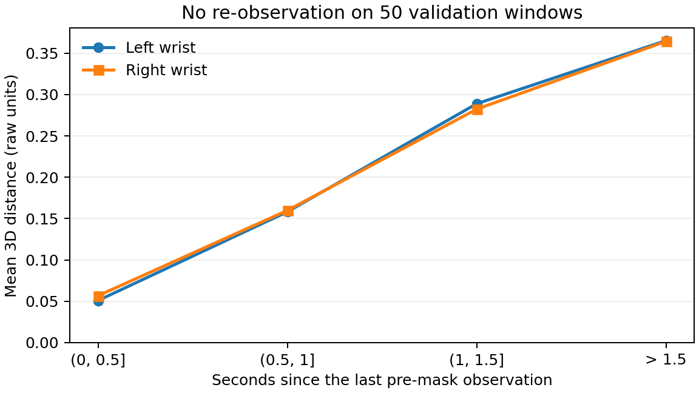

# 双腕缺测时长与首轮回访诊断

在相同的 50 个验证窗中，各手保持最后一个可靠腕点。按环境等权计算，缺测前 0.5 秒的平均三维距离误差为左 0.0509、右 0.0567，最后半秒为左 0.3652、右 0.3642。距离沿用记录坐标单位。下图每一点都是整个时段的均值。[队伍决定](../docs/decisions.md) · [脚本](c_q2_diagnostic.py)



| 距遮挡前最后一次可靠采样的时间 | 每手评分时刻数 | 左腕均值 | 右腕均值 |
|---|---:|---:|---:|
| (0, 0.5] 秒 | 739 | 0.0509 | 0.0567 |
| (0.5, 1] 秒 | 750 | 0.1582 | 0.1599 |
| (1, 1.5] 秒 | 750 | 0.2889 | 0.2823 |
| 1.5 秒至遮挡结束 | 750 | 0.3652 | 0.3642 |

**分母与权重。** 5 条合格记录来自 3 个环境，每手共 2,989 个评分时刻。各时长段均有 50 窗。每条记录先在段内平均逐时刻误差，每个环境等权平均它的合格记录，主图再等权平均三个环境。全窗均值在全部时刻上重新计算。参考池沿用 1 秒历史加 2 秒遮挡的非重叠窗，要求显式正常且双腕坐标合格。验证集另有 2 条 Demo 记录在此口径下为零窗，涉及 1 个完全没有合格窗的环境。[全部 7 条记录的窗数与账本](q2_diagnostic/validation_accounts.csv)

| 验证环境 | 各记录的窗数 | 全窗不回访左腕均值 | 全窗不回访右腕均值 |
|---|---|---:|---:|
| 物流 0022 | V03 有 11 窗，V04 有 11 窗，V06 有 16 窗 | 0.0929 | 0.0942 |
| 餐饮 0004 | V05 有 9 窗 | 0.1437 | 0.1594 |
| 商超 0074 | V07 有 3 窗 | 0.4111 | 0.3941 |

物流的 38 个窗和商超的 3 个窗各占总均值的三分之一。商超结果仅来自一条记录。CSV 中 `record`、`environment`、`macro` 分别是逐记录、逐环境、环境等权结果，`timestamps` 是每手的分母。[按记录和环境的全时长曲线](q2_diagnostic/validation_curves.csv)

**一次回访。** 固定在首个被遮挡的真实采样时刻先提交预测再请求。双腕 XYZ 使用同一源时刻，到期时整包披露，若回执与下一预测同刻则先收包。两腕各自保持最近已收到的值。新包只将可靠观测的源时刻向前推进了一个采样间隔，50 窗的中位数为 33.332 毫秒。这个时机下，即使 0.5 秒后收包，收到的也是请求时刻的腕点。

| 验证条件 | 请求 / 回执（包） | 总费用 | 在途等待合计（秒） | 左腕全窗均值 | 右腕全窗均值 |
|---|---:|---:|---:|---:|---:|
| 不回访 | 0 / 0 | 0 | 0 | 0.215919 | 0.215915 |
| 窗首请求一次，延迟 0.5 秒 | 50 / 50 | 100 | 25 | 0.214338 | 0.214820 |

**供队伍确定容差与延迟范围的训练数据。** 同口径保留 328 窗、28 条记录、10 个环境，每手 19,639 个评分时刻。不回访时，首半秒的训练误差第 90 百分位为左 0.1705、右 0.1684，末段为左 0.8097、右 0.8346。分位数用每环境等总权、环境内每记录等总权的经验分布计算。四段中位数及第 90 百分位可按应用关注的时长查表。为换算应用给出的距离容差，仍需核对腕点物理长度单位。[训练误差分位数](q2_diagnostic/train_no_request_quantiles.csv)

固定请求时机和费用后，预先取 0.25、0.5、1 秒三档训练延迟。三档的左腕全窗均值依次为 0.1934、0.1942、0.1957，右腕为 0.2045、0.2054、0.2070。每档均为 328 包、费用 656，在途等待合计 82、164、328 秒。三档均接收同一源时刻的包，因此在所有回执都已到达后预测一致。验证仅跑队伍指定的 0.5 秒条件。正式容差与范围留待队伍结合应用条件确定。[训练分层曲线](q2_diagnostic/train_curves.csv) · [训练分记录账本](q2_diagnostic/train_accounts.csv)

## 复现

从讨论 worktree 根目录运行。分箱采用实际纳秒差，最后一段包含至窗末的所有评分时刻。`method=no_request` 时 `delay_ms=0` 是无请求的占位值。所有公开数表均为聚合值。AI 辅助内容为已选基线的诊断脚本、固定动作账本验收、聚合计算与制图，由队员独立核验。

```bash
PY=/mnt/disk/zhoutianyu/miniconda3/bin/python
CROOT=../SWBMCM2026/data/raw/C
"$PY" -B research/c_q2_diagnostic.py --root "$CROOT" --split validation
"$PY" -B research/c_q2_diagnostic.py --root "$CROOT" --split train
"$PY" -B research/test_c_q2_diagnostic.py
```
