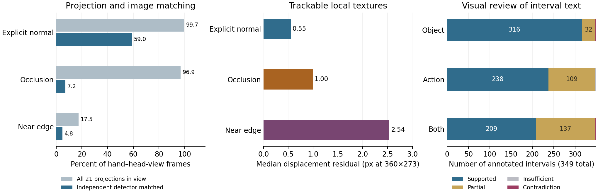

# C 题逐帧视频与官方标注交叉核验

本轮的对象是视频像素能否为官方轨迹、质量标记和区间文字提供佐证。69 条记录、184 路视频、178,512 个相机帧，共用上一轮已核对的发布时钟。每条轨迹的索引用内部 `episode_uuid` 连接官方划分，视频使用展示帧序，语义按原记录时间的半开区间理解。资料审计涵盖三个划分，赛事模型仍须在训练/验证选定并冻结后另行评价。[上一轮文件与几何核对](C题全量多模态数据复核.md)

**主要结果。** 五位 `general-pro` 分别完成独立手部检测、轨迹局部运动核对、语义时钟与画面变化、区间画面研读和冻结图文模型的逐帧检索。全部 178,512 帧都获得独立手检测结果（允许零候选）和图文向量。两个头摄的全部相邻帧对都运行了运动估计。主会话另对全部 66,070 个双目时刻检查投影位置的纹理，按相同源时刻、手别、关节和区间核对各项结果。遮挡组整体上更难检测、可比局部位移残差更大；精确到单帧的标签切换和精确到商品品类的语义仍需具体复查。



## 怎样理解分母与证据

- 66,070 个时刻含 132,140 个手时刻。两路头戴相机可比较同一只手，进行跨眼匹配时一对只计一次。46 路腕摄缺少世界外参，画面里也可能出现对侧手；腕摄检测到手与“已核实哪只手的哪一关节”需要不同依据。
- 两手合计有显式本手坏原因的 1,000 个手时刻，含遮挡 937、靠近边缘 63；按记录时刻取并集后为 828 个。Demo 稀疏未列与“仅另一手标坏”的未知状态单独统计。图像模型输出和原始标注的差异，还受视场、图像纹理、快速运动、遮挡、左右手关联及标签时基影响。[逐手质量定义](C题全记录轨迹与语义核查.md)
- 349 个语义区间给出区间级动作描述。主时基下覆盖 65,765 个唯一轨迹时刻，305 个在最后区间右端点或其后。可逐帧核对覆盖和图像特征；“拿起、转向、放下的确切时刻”只有在有独立阶段边界参照时才能评价。
- 密集指标的逐帧数值保存在本机。不同来源与同一记录相邻帧有关联，数百万关节点不能充当数百万个独立样本。这是标注一致性审计，不用测试侧结果调整阈值或选择参赛方法。

## 本地逐帧复核

在本机打开 `runs/c_dense_frame_viewer/index.html`，选择记录后可通过滑块、源帧号或左右方向键逐帧移动，头部和实际存在的腕部相机同步定位。首次进入默认只看画面，可以先描述哪只手、哪个物体及何种动作清楚可见，再打开“显示官方标注”阅读手别原因与当前区间的原始英文描述。“下个手部坏标记”“下个语义区间”用于有目标地查疑点；这类定向复查的样本不宜作为发生率的分母。

查看器从已经全解码验证的每路 PTS 推得对应展示时段，将播放器定位至时段中点，屏幕显示轨迹的源帧号和源时刻。可独立切换头摄的官方投影、各路 RGB 像素的独立手检测和本帧核对读数。官方绿点为左手、紫点为右手，橙圈为画面模型的全部候选，出框点省略。双目读数是本手有纹理关节上相关优势的中位数，运动残差是两眼同时可比时先对两眼像素误差取平均，再在该手关节上取中位数；读数同时列分母。核对得到 69 个记录页、184 路视频、66,070 个源时刻及 178,512 个视角帧；区间索引对照得到相同的 65,765 个半开覆盖时刻。已在本地 Chromium 实测四个视频定位完成、揭示标记、跳至下个标记、逐帧前进、双目投影、四路独立检测叠图和打开读数。每段的语义文字保存在本机界面，不能用作 Q3 在线输入。[生成脚本](../experiments/c_dense_frame_viewer.py)

```bash
PY=/mnt/disk/zhoutianyu/miniconda3/bin/python
"$PY" -B -m experiments.c_dense_frame_viewer --evidence runs/c_dense_joint_check --detectors runs/c_dense_detector/predictions
```

## 独立图像手检测与官方标记

五项子任务中的手部检测对 184 路共 178,512 帧逐帧运行固定版本 MediaPipe Hands，仅以 RGB 为输入并关闭前帧跟踪。得到 115,451 帧至少一个候选，63,061 帧零候选。检测落盘后在两个头摄上以可见掌点几何位置关联左右手。以 Pro/Standard 本手标为 `occlusion` 的全部 1,556 个手视角为分母，能稳定配上的有 120 个（7.71%）。同记录、同手、同眼显式正常样本按遮挡样本构成加权为 49.21%，相差 41.50 个百分点。两种数据在群组层面一致支持遮挡下图像证据较难获得；单个未配上可能来自模型漏检、视角、候选混淆或官方轨迹偏差。

两眼去重后，937 个本手遮挡时刻中，27 个两眼均稳定匹配、80 个仅一眼、830 个两眼均未匹配。在后者中，688 个手时刻仍有至少一个关节具备双目纹理和两眼光流可比较证据。局部图像跟踪可能跟踪到手、衣物或同动商品，独立整手检测还要求看得出整手形态。结合查看两项证据的分母可以定位值得复查的样本。腕相机仅记录候选数量与像素位置，无法按头摄的几何约束确定其本手身份。[独立检测、镜像负对照与误差](C题全帧手部检测与官方标记对照.md) · [按独立候选及局部证据的交叉计数](c_dense_audit/cross_detector.csv)

**坏段边界精确到帧时，现象较弱。** Pro/Standard 有 147 个本手连续 `occlusion` 原因段，其中 101 段的紧邻前一帧及后一帧都显式正常。把任一头眼稳定配上记为“有对应”，101 段中只有 8 段在标记起点从有对应变成无对应，5 段反向变化，82 段的起点和前一帧均无对应。换到正常标记的第一帧时，仅 5 段从无对应变成有对应。每个手段只计一次，间隔大于 50 毫秒断开。这个结果支持按邻域检查检测困难，直接用模型首次丢手的帧替代官方遮挡起点会错过大部分可比较事件。[事件对账](c_dense_audit/onset_matches.csv) · [事件提取](../experiments/c_dense_onset_check.py)

## 手部轨迹：同时检查两眼外观与前后帧运动

在左右头摄同一时刻，以官方给出的 21 点世界坐标和实测相机内外参投影。两眼按等比例缩到 480×364，保留像素中心映射 `(xy + 0.5)/4 − 0.5`，在左右投影中心取 9×9 灰度块。比较正确中心的零均值归一化互相关（ZNCC），以及右眼中心上移、下移各 12 个缩小像素所得两份相关的均值。只在三个右块和左块均完整、各自灰度标准差 ≥5 时计入共同分母。阈值和对照偏移统一使用。该量受透视变形、遮挡物、皮肤纹理、背景及左右眼曝光差影响。另用前一帧投影的局部光流，在后帧独立核对预测位移。各项用相同记录、源时钟、手别与关节号连接。

| 本手标签 | 左右头摄同步关节点对 | 可比较纹理 | 投影位置平均 ZNCC / 错位平均 | 同时具备双目和两眼光流证据的点 | 两种核对均优于各自对照 |
|---|---:|---:|---:|---:|---:|
| 显式正常 | 2,055,312 | 1,058,882 | 0.543 / 0.088 | 883,577 | 561,605（63.6%） |
| 遮挡 | 19,677 | 8,503 | 0.255 / 0.028 | 7,159 | 2,746（38.4%） |
| 靠边缘 | 1,323 | 103 | 0.375 / 0.201 | 52 | 32（61.5%） |
| 另手有标记，本手未知 | 13,776 | 5,164 | 0.444 / 0.040 | 4,298 | 2,713（63.1%） |
| Demo 稀疏未列 | 684,852 | 382,137 | 0.550 / 0.063 | 335,248 | 226,925（67.7%） |

全部 2,774,940 个同步双眼关节点对都有归账，其中 1,230,334 个同时支持两项对照。最后一列要求投影位置相关严格高于上下错位参照，且两眼平均光流误差严格低于两眼平均零位移误差。百分比在上一列的共同可比分母上计算。`near edge` 只剩 52 个共同可比点，约占该层全部点的 3.9%；其百分比不宜直接与显式正常比较。两个对照都依赖同一官方空间位置，彼此并非两套独立的物理真值。重复背景纹理会匹配，共同运动的商品也会产生稳定光流。[双目汇总](c_dense_audit/stereo_patches.csv) · [同点交叉核对](c_dense_audit/cross_evidence.csv) · [光流错位与背景对照](C题逐帧图像运动与轨迹一致性.md)

**记录内配对。** 对显式质量 CSV 的 778 个本手遮挡手时刻，在同记录同手找前、后各一处 0.25–1 秒内最近的显式正常时刻。697 个有两侧时间对照，496 个还能在相同关节上同时取得三时刻纹理证据，来自 16 条记录、12 个环境。每时刻先对共同关节平均，再按记录和环境等权汇总，“投影位置相关 − 错位相关”在遮挡时为 0.288，在前后正常对照时为 0.441，差为 −0.153。63 个靠边缘手时刻仅 7 个能完成此配对，集中在 1 条记录。正常对照可能复用；这组描述不识别遮挡的因果效应。合成纹理的已知平移、低纹理和坐标边界均已独立核对。[匹配对照分母](c_dense_audit/stereo_matched.csv) · [合成检查](../checks/test_c_dense_stereo.py)

## 逐帧图像与语义边界

实际用源时钟对 178,512 个视角帧分配区间，有 177,692 帧得到标注区间，820 帧在末段结束处或以后。若改用视频展示时钟分段，有 492 帧改变段归属。源时钟的 280 处内部边界，展开为 724 个视角边界，722 个有合格的前后邻域对照。在 279 个头部配对边界中，196 个的局部图像变化高于同段邻域；腕摄为 55/82。头部在真实边界比对照多出约 11.16°/秒的相机角速度，因此运动变化只能为边界邻域提供支持，不能单凭某处像素峰值恢复手部动作起止。[真实边界、段中伪边界、一帧错位及分母](C题逐帧画面变化与标注边界.md)

**区间语义的可见证据。** 对全部 349 段各取三个确属区间内的不同源帧，在 1,047 张头左图上对照原文的物体和动作，再为 7 个难段查看 10 张补图。AI 核读对 209 段找到物体和动作的明确支持，137 段部分支持，2 段图像证据不足，1 段的商品品类用词与画面有明确冲突。该训练段英文写 `mineral water`，实际柜中整提包装可读“饮用纯净水”，搬运到柜子上层的动作有画面支持。这个差异是品名层级的复核线索，不能据此删除整个动作段。区间取样复核未计物体的物理成分，亦不能直接计算动作成功率或数据整体错标率。[逐区间核读及分组表](C题逐语义区间画面复核.md)

**逐帧图文检索对照。** 固定 OpenAI CLIP ViT-B/32 的图像塔逐帧编码全部 178,512 帧，英文原文只进入文本塔。按 177,692 个有段归属的相机帧和源时钟汇总，候选为同一记录内不同文字，区间外帧不参加语义评分。335 段有异文可比，14 段所在记录只有一种描述。在 62,675 个可对照的多视角源时刻，原配文字第一名积分占 35.89%，逐时刻均匀猜测基线为 23.97%。按段等权时，原配在 97/335（28.96%）排第一，均匀基线为 24.37%。对两段的文字交换计分，原配总分较高的有 243/335 个有向配对。相似货物、近义动作和中心裁切都会影响模型辨别力；平均逐帧特征还会丢失取物与放回的顺序。[全量图文模型、PTS 核对与负对照](C题逐帧图文一致性复核.md)

按同一源记录和片段序号，与独立进行的区间读图结果逐项连接，349 段的两侧对齐帧数全部相等。在“画面可见支持”且有异文可比的 196 段中，CLIP 仅在 66 段把原配排第一；上面的水包装品名疑例虽未排第一，仍可在特定二选一对照中胜过下一条异文。故低检索排名不能直接用来清洗标注，高于错配也不能核实文字的细节。[跨方法交叉表](c_dense_audit/text_review.csv) · [对账脚本](../experiments/c_dense_text_review_join.py)

本次双目复现使用 `python -B -m experiments.c_dense_stereo_patches`，同一来源的中断任务可带 `--resume` 复用完整记录。`--summary-only` 从本地逐时刻文件重建各来源、划分、质量组的聚合。运行 `python -B -m experiments.c_dense_evidence_join --detector runs/c_dense_detector/comparison` 连接已生成的双目、光流与独立手检测证据，再按上节命令生成本地查看器。使用已有本地 Conda Python 及 FFmpeg，无需传出画面。[双目计算](../experiments/c_dense_stereo_patches.py) · [同点连接](../experiments/c_dense_evidence_join.py)
