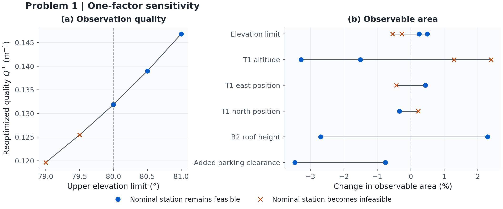

# 第一问｜参数敏感性复算

此前已有三档网格对照和 [80° 收紧至 79° 的单点检算](../../../research/B题四问_约束复核.md#q1-和-q21-的仰角上限)。本次在[题面标称工况](../可观测区域与最优站位_连续圆弧_20261120/conclusions.md)上做 **6 类、16 组**单因素扰动，另复算标称行。每次只改一项，用同一规则重新选站，并把原推荐站固定不动重新验收。试算幅度不是题设允许误差，也不用于估计失效率。

## 比较指标和方法

- **重新选站。** 若场景中能找到一个站达到仰角给出的距离下界，则 $r^*=(H-h_c)\cot\beta_{\max}$，$Q^*=\tan\beta_{\max}/(H-h_c)$。对每个工况分别验证取等，再在同分站点中最大化最小车体净空。表中的站位移动量是两站之间的平面直线距离，不是车辆行驶路程。
- **固定原站。** 保留全精度车心 $(88.82541010709,76.32285407485685)$ m，按变化后的场景单独验收车体、三维视线和仰角。
- **连续可观测面积。** 使用最大宽度 $5\times10^{-5}$ m 的竖条上下包络，所有工况的面积区间宽度均小于 0.0072 m²。下表用区间中点算相对变化；CSV 保留上下界和相对标称的面积差区间。
- **额外净空。** 设置 $c(P)\ge\delta$，而不是增大实体车身；计算停车可行域时等效为车心与楼底、场界的距离至少 $1.5+\delta$ m。标称点达到主目标，与净空全局上界之差不超过 $9.15\times10^{-13}$ m，且满足本次附加门槛。缩小可行域后，原上界仍然有效，同一站位仍在原误差界内最优。

## 实测结果

标称 $Q^*=0.131890274875\ \mathrm{m}^{-1}$，连续可观测面积约 **5608.77 m²**，最小车体净空 **9.6746 m**。下表的变化范围只覆盖所列试算点。

| 单独改变的参数 | 试算幅度 | $Q^*$ 相对变化 | 连续面积相对变化 | 原站失效的试算点 |
| --- | --- | ---: | ---: | --- |
| 云台仰角上限 | ±0.5°、±1° | −9.29% 至 +11.33% | −0.54% 至 +0.49% | 下降 0.5°、1° |
| T1 高度 | ±1 m、±2 m | −4.44% 至 +4.88% | −3.28% 至 +2.40% | 升高 1 m、2 m |
| T1 东向坐标 | ±0.5 m | 0 | −0.43% 至 +0.44% | 向东 0.5 m |
| T1 北向坐标 | ±0.5 m | 0 | −0.34% 至 +0.22% | 向北 0.5 m |
| B2 楼高 | ±1 m | 0 | −2.70% 至 +2.30% | 无 |
| 附加停车净空 | +0.10 m、+0.45 m | 0 | −3.47% 至 −0.76% | 无 |

1. **仰角上限降到 79° 时，重新选站约移动 1.120 m。** 最优站距从 7.5821 m 变为 8.3584 m，$Q^*$ 下降 9.29%，但重新选站的最小车体净空由 9.6746 m 增至 9.9757 m。这里的仰角余量以牺牲部分观测质量换取，不能把 79° 工况的站位写成 80° 原题的严格最优点。
2. **最优质量不变，不代表图形或站位不变。** T1 水平投影各轴平移 ±0.5 m，重选后仍能达到原 $Q^*$，但选站移动约 0.367–0.625 m。B2 加高 1 m 使连续面积减少约 151.42 m²，推荐站和 $Q^*$ 不变；额外停车净空提高到 0.45 m 时，面积降至约 5414.20 m²，仍不必挪动推荐站。这些对照分别反映遮挡和停车约束对全场可观测域的影响。
3. **原推荐站没有仰角余量。** 16 组扰动中有 **6 组**固定原站时不再可行，全部因仰角超限，不是净空不足或视线被挡。重新求解后，各工况均达到各自的最优距离。原题的 80° 标称解不改；若实际参数偏离标称，应按实际云台限位和更新后的告警坐标重验仰角，而不是把较大的停车净空视作观测余量。

这里报告的是单因素试算，不覆盖参数联动或停车、告警误差的联合分布，也不检验车辆最短行驶距离的同分规则。站位结论使用第一问归档的最大最小车辆净空规则。

[逐工况底表](sensitivity.csv) · [论文矢量图](sensitivity.pdf) · [独立验收](validation.json) · [复跑记录](run_record.md)
