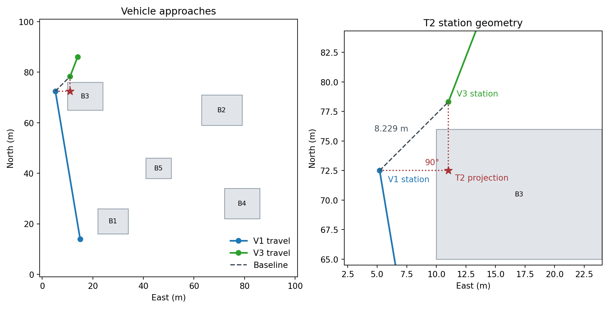
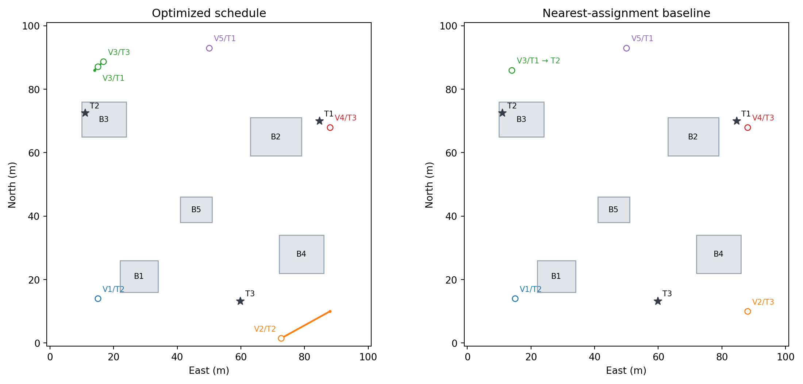
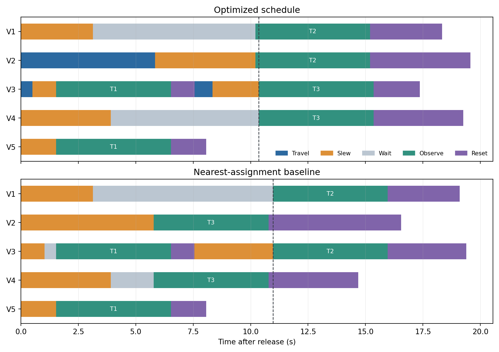

# Problem 2 Results, Tables, and Figures

## Two-Station Localization of T2

The accuracy metric is the first-order horizontal root-mean-square error. Independent bearing errors have a standard deviation of $\sigma=\pi/180$ rad. Linearizing the two bearing equations at the nominal position gives

$$
E=\sqrt{\operatorname{tr}\Sigma}
 =\frac{\sigma\sqrt{r_1^2+r_2^2}}{|\sin\gamma|},\qquad
B^2=r_1^2+r_2^2-2r_1r_2\cos\gamma,
$$

where $r_i$ is the horizontal range of station $i$, $\gamma$ is the horizontal intersection angle, and $B$ is the baseline. The metric combines the two horizontal error components in metres and is invariant under rotation of the coordinate axes. The elevation limit yields $r_i\ge 33/\tan 80^\circ$. Both stations attain this distance and their bearings intersect at 90°, so the first-order RMSE attains its lower bound of **0.143623358 m**. The baseline is **8.229012248 m**.

**Table 1. Optimal station pair and travel times for T2.**

| Vehicle | Initial center (m) | Station center (m) | Range (m) | Travel distance (m) | Travel time (s) | Elevation |
| --- | --- | --- | ---: | ---: | ---: | ---: |
| V1 | (15, 14) | (5.210066466, 72.500000000) | 5.818790363 | 59.313513 | 19.771171 | 80° |
| V3 | (14, 86) | (11.028856830, 78.318790363) | 5.818790363 | 8.235816 | 2.745272 | 80° |

The straight approaches and three-dimensional lines of sight are feasible, and each trip takes less than 30 s. Let $q=(50-45\sqrt{3}/2,72.5)$ and $r_0=33/\tan80^\circ$. The exact station centers are $(q_x-r_0,q_y)$ and $(q_x,q_y+r_0)$.

As the intersection angle approaches 0° or 180°, the bearing Jacobian becomes ill-conditioned. Exclude collinear pairs and prefer a geometry closer to a right angle for near-collinear pairs. A station on an admissible elevation or vehicle boundary can still support a full-rank intersection. A sightline that touches a building is occluded and requires a station on the visible side. [Station and route data](q21_result.json) · [Noise and boundary sensitivity](q21_sensitivity.csv)

*Figure 1. Straight vehicle approaches and horizontal projection of the optimum T2 geometry. Dotted lines are the projected bearings, whose sightlines clear the roof of B3. The dashed line marks the station baseline.*

## Vehicle Assignment and Routing for Three Concurrent Alerts

The objective is the maximum of the three synchronized observation start times. A vehicle slews upon arrival, may wait for its partner, observes jointly for 5 s, and resets before its next departure. The two gimbal axes rotate in parallel at up to 30°/s. The nearest-assignment baseline minimizes the sum of the two obstacle-avoiding travel distances for each alert. It breaks ties by earliest common readiness and then by identifiers. The reported baseline is the best of the six alert processing orders.

**Table 2. Station assignments and synchronized observation start times.**

| Alert | Optimized station centers (m) | Start (s) | Nearest-assignment station centers (m) | Start (s) |
| --- | --- | ---: | --- | ---: |
| T1 | V3 (15.042, 87.078), V5 (50, 93) | 1.532033 | V3 (14, 86), V5 (50, 93) | 1.532033 |
| T2 | V1 (15, 14), V2 (72.680, 1.510) | 10.204157 | V1 (15, 14), V3 (14, 86) | **10.968984** |
| T3 | V3 (16.767, 88.660), V4 (88, 68) | **10.352849** | V2 (88, 10), V4 (88, 68) | 5.777589 |

**Table 3. Nonzero travel legs in the optimized schedule.**

| Vehicle | Alert | Straight route between vehicle centers (m) | Distance (m) | Travel time (s) |
| --- | --- | --- | ---: | ---: |
| V3 | T1 | (14, 86) → (15.042, 87.078) | 1.499282 | 0.499761 |
| V3 | T3 | (15.042, 87.078) → (16.767, 88.660) | 2.340587 | 0.780196 |
| V2 | T2 | (88, 10) → (72.680, 1.510) | 17.515208 | 5.838403 |

All other legs are stationary, including all six legs of the nearest-assignment baseline. The full minimum vehicle-center separation is **33.515189 m** for the optimized schedule and **36.674242 m** for the baseline. [All waypoints](q22_routes.json) · [Independent validation](validation.json)

*Figure 2. Vehicle routes for the optimized schedule and nearest-assignment baseline. Open circles mark stations. Stars mark alert projections.*

**Table 4. Complete optimized vehicle timelines. All times are in seconds.**

| Vehicle | Alert | Depart | Arrive | Slew interval | Wait duration | Observation interval | Reset interval | Next departure |
| --- | --- | ---: | ---: | --- | ---: | --- | --- | ---: |
| V1 | T2 | 0.000000 | 0.000000 | 0.000000–3.129448 | 7.074709 | 10.204157–15.204157 | 15.204157–18.333605 | — |
| V2 | T2 | 0.000000 | 5.838403 | 5.838403–10.204157 | 0.000000 | 10.204157–15.204157 | 15.204157–19.569911 | — |
| V3 | T1 | 0.000000 | 0.499761 | 0.499761–1.531921 | 0.000111 | 1.532033–6.532033 | 6.532033–7.564193 | 7.564193 |
| V3 | T3 | 7.564193 | 8.344389 | 8.344389–10.352849 | 0.000000 | 10.352849–15.352849 | 15.352849–17.361309 | — |
| V4 | T3 | 0.000000 | 0.000000 | 0.000000–3.908053 | 6.444795 | 10.352849–15.352849 | 15.352849–19.260902 | — |
| V5 | T1 | 0.000000 | 0.000000 | 0.000000–1.532033 | 0.000000 | 1.532033–6.532033 | 6.532033–8.064065 | — |

**Table 5. Complete nearest-assignment baseline timelines. All times are in seconds.**

| Vehicle | Alert | Depart | Arrive | Slew interval | Wait duration | Observation interval | Reset interval | Next departure |
| --- | --- | ---: | ---: | --- | ---: | --- | --- | ---: |
| V1 | T2 | 0.000000 | 0.000000 | 0.000000–3.129448 | 7.839536 | 10.968984–15.968984 | 15.968984–19.098432 | — |
| V2 | T3 | 0.000000 | 0.000000 | 0.000000–5.777589 | 0.000000 | 5.777589–10.777589 | 10.777589–16.555179 | — |
| V3 | T1 | 0.000000 | 0.000000 | 0.000000–1.023217 | 0.508816 | 1.532033–6.532033 | 6.532033–7.555249 | 7.555249 |
| V3 | T2 | 7.555249 | 7.555249 | 7.555249–10.968984 | 0.000000 | 10.968984–15.968984 | 15.968984–19.382719 | — |
| V4 | T3 | 0.000000 | 0.000000 | 0.000000–3.908053 | 1.869536 | 5.777589–10.777589 | 10.777589–14.685643 | — |
| V5 | T1 | 0.000000 | 0.000000 | 0.000000–1.532033 | 0.000000 | 1.532033–6.532033 | 6.532033–8.064065 | — |

*Figure 3. Five-vehicle timelines for the optimized schedule and the nearest-assignment baseline. Each dashed line marks the latest synchronized start in the corresponding schedule.*

The optimized schedule advances the latest start by **0.616135 s (5.617%)**. The baseline holds V3 at its initial position for T1 and T2, with a 3.413735 s second slew. The optimized schedule assigns T2 to V1 and V2 in parallel and reuses V3 for T3. The second slew takes 2.008460 s, compensating for the 0.780196 s transfer and the increase in reset time. The continuous-field numerical lower bound is 10.352000 s, within 0.849 ms of the verified schedule. [Timing data](q22_timeline.csv) · [Heuristic orders and critical chains](q22_comparison.json) · [Lower bound](continuous_bound.json)
