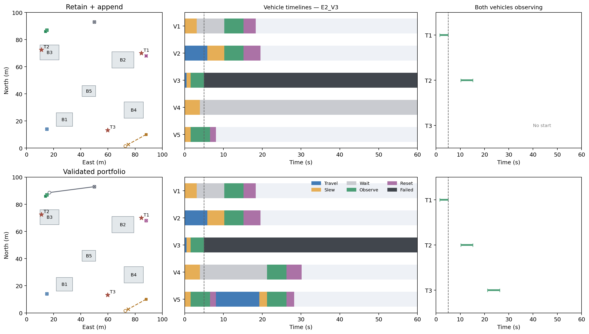

# B 题第四问｜多模型动态重调度

**推荐结果：** CP-SAT 是最佳单算法；最终时间表对每个情景从四种已验证的算法解和两条保留原计划基线中按官方字典序择优。1,751 个主情景全部实现 **η=1**，平均最晚开测 **34.482 s**；原计划不重排、仅可追加的基线为 **83.248% / 48.084 s**。相对于这个较强基线，**1,168** 个情景多启动一项告警，另有 **52** 个情景仅缩短时间，**531** 个情景持平，无退化。总平均包含未全启时按题意记入的 60 s；仅比较两种策略都全启的 583 个情景，平均提前 **0.043 s**，最多提前 **1.801 s**。

[原规范审核及模型](../../../docs/B题第四问_方案审核与实现说明.md) · [英文论文图表底稿](tables_and_figures.md) · [逐情景指标](scenario_metrics.csv) · [运行及复核](run_record.md)

## 七类扰动的实测对照

| 场景（数量） | 保留并追加 η 均值 | 重调度 η 均值 | 保留并追加平均最晚启动（s） | 重调度平均最晚启动（s） |
|---|---:|---:|---:|---:|
| 新告警（72） | 100% | 100% | 20.410 | 20.265 |
| 故障（5） | 73.33% | 100% | 50.071 | 26.066 |
| 断联（3） | 100% | 100% | 10.353 | 10.353 |
| 新告警 + 故障（360） | 80.00% | 100% | 52.284 | 28.825 |
| 新告警 + 断联（216） | 100% | 100% | 25.246 | 25.246 |
| 故障 + 断联（15） | 73.33% | 100% | 50.071 | 36.071 |
| 三种同时（1,080） | 80.00% | 100% | 53.165 | 39.247 |

新告警主网格覆盖 24 个方位（15° 步长）和 30、40、50 m 三个距离，T4 高度均为 50 m。五种单车故障全枚举，故障维度条件等概率；恢复时刻取 10、20、30 s，对应停联 5、15、25 s。72 个主网格位置中，各目标保守 1 m 网格可观测点数在 **5,105–6,778** 之间。另取差异最大的相邻格中点六处，覆盖穿过 0° 的邻接区间，并与故障和通信网格组合出 **144** 个加密情景，择优结果也全部成功启动。几何中点和筛选依据见 [加密清单](critical_refinement.json)。新告警与恢复时刻均无给定概率分布，不把各情景等权均值当成现实中的概率期望。

严格冻结对照不接收 T4，主样本仅 **7** 个场景全启。推荐使用较强的“保留并追加”对照：不可替换原任务的失效车，不推迟任何已有可执行原任务，但给新增告警配对使用余下容量。[汇总底表](category_summary.csv) · [单车故障](failure_summary.csv) · [通信恢复](recovery_summary.csv) · [T4 方位及距离](spatial_summary.csv)

## 哪种算法最好

四种方法在主样本都得到 η=1。A/B 固定单线程、同为 1.5 s 单场景预算，D 提供共享初稿，ALNS 每场景用 10 个固定种子；时间指各算法求解段，不含公共候选生成，A/B/C 也不含附加的 D 初稿用时。

| 方法 | 平均最晚开测（s） | 匹配逐场最佳官方分数 | 证明有限模型最优的情景 | 求解中位数（s） |
|---|---:|---:|---:|---:|
| CP-SAT | **34.482049** | **1,749/1,751** | **1,747** | **0.0305** |
| ALNS（10 种子择优） | 34.497233 | 1,732/1,751 | — | 0.1981 |
| SCIP MILP | 34.583223 | 1,612/1,751 | 1,296 | 0.0704 |
| 双车增量插入 | 34.598193 | 1,592/1,751 | — | 0.1182 |

CP-SAT 其余 4 个主情景在可生效时已无未启动任务，原样执行；MILP 另有 451 个只有已验收可行解。ALNS 有 143 个主情景的种子间最晚开测标准差非零，不能把最优种子当典型。逐场行车结果的精确时间基于连续回放；`E7_A210_R40_V2_C10`、`E7_A210_R50_V2_C10` 的 ALNS 各比 CP-SAT 记录的连续结果早 **0.033331 s**，这是离散求解与连续执行排序不同的例子，不推翻 0.1 s 离散最优证书。[模型与证明计数](algorithm_summary.csv) · [ALNS 稳定性](alns_stability.csv)

**最优性的边界：** 证书针对冻结旧站、有限新站对、固定避障折线和按顺序最早发车的整数模型；不证明连续站点、可延迟出发规避冲突、另选路径或全部未知扰动下的全局最优。主实验的 100% 是情景内达标，不是可靠性概率。

## 收益和限制从哪里来

1. **故障修复，`E2_V3`。** T1 在 1.532 s 已开测，V3 在 5 s 退出，T1 仍计成功。V4 已为 T3 就绪，保留原计划时缺搭档，只能等待。重调度保持 T2 的 V1/V2 指派不变，V5 完成 T1 剩余过程并在 8.064 s 复位后，走 33.515 m 去 `(16.767, 88.660)` 替 V3；V4 留 `(88,68)`。V5 在 19.236 s 到站，指向后使 T3 于 **21.244 s** 开测。官方分数从 **(2/3, 60)** 变为 **(1, 21.244)**；60 s 是未全启罚值。V1/V2/V4 的故障也会影响未启动原告警，V5 故障则只影响已经开测的 T1，不破坏后续原任务。
2. **纯断联和新告警加断联。** 纯断联无新指令要求，T1–T3 顺利按 1.532、10.204、10.353 s 开始，三种恢复时刻均相同。在 E5 的 216 个主情景中重调度没有进一步改善官方分数；T4 的及时性取决于恢复与后续双车就绪。若没有断联，T4 可在有利情景提前插队。例如 `E4_A345_R50_V5` 由 V2/V4 先做 T4，T2/T3 随后开测；四项仍全部启动，最晚开测从 **20.700 s** 到 **18.899 s**，比仅追加早 **1.801 s**。
3. **最迟情景，`E7_A90_R50_V2_C30`。** V2 故障导致 T2 不能同步，恢复前 V1 按旧指令留站，T1/T3 已合法开测。30 s 恢复后，V4 绕 B4 走 **70.873 m** 到固定 T2 东南站 `(72.680, 1.510)`，耗时 **23.624 s**，再指向 **4.366 s**。V1 和 V3 先做 T4（31.998 s 开测），V1 复位再对准 T2 后等待 V4。最晚开测 **57.990 s**，仅留 **2.010 s** 的启动余量；保留原方案只能启动三项。共有 **146** 个主情景并列最迟，均为 V1 或 V2 故障且 30 s 恢复。瓶颈是恢复后接续远程固定站，不是车队总数本身。E7 在恢复 10/20/30 s 的平均最晚启动分别为 **31.237 / 38.252 / 48.252 s**；恢复时已无可并行推进的旧车次后，该时间差直接进入受阻任务的关键链。求解、下发延迟未计入物理时间，现场不能把 2.010 s 当成有保证的裕量。
4. **新告警方位与路长，`E4_A120_R30_V3` 至 `E4_A135_R30_V3`。** 固定 V3 故障、距离 30 m，方位从 120° 变至 135° 时，四条告警照常全启；但 V2 从 T2 转往所选 T4 站的路长从 **1.856 m** 增至 **15.570 m**，最晚开测从 **24.126 s** 到 **29.109 s**。加密的 127.5° 样本对应 **7.647 m / 26.277 s**，说明不能仅看完成率判断方位影响。

右栏只画两车都处于观测状态的区间；T1 的双车观测在 **5 s** 结束，合法启动仍计分。中栏的 V5 独自保留观测占用至 **6.532 s**，复位至 **8.064 s** 后才替补。 [PDF](representative_timeline.pdf)

## 近边界、站位和定位质量

- **时间精度：** 12 个覆盖七类的 0.05 s 复算和 12 个允许恰好 60 s 的复算，均未改变官方分数；额外复查最慢例与两处连续排序差，逐场择优的连续分数不变。8 个 T4 半米网格及扩大站对目录对照中，只有一个有变化，提前 **0.005894 s**，均全启。
- **站位瓶颈：** 另许未启动的旧告警重选站，不重写初始 5 s 计划。12 个原场景中 10 个提前，最大 **23.177 s**；对最慢三扰动例单独复算可从 **57.990 s** 降至 **36.373 s**。这份收益来自**站位与重调度联合调整**，不混入主表。若现场确可换旧站，这是增大抗断联裕量的优先方向，而非保证全部未测情景也有相同改善。
- **交会质量：** Q4 官方只按成功启动和时间排序，时间最短不等于定位最稳。主网格有 T4 的 1,728 个推荐方案中，30 个 T4 交会角距 0° 或 180° 小于 5°。对这 30 个全部重跑，增加距退化边界 **5°** 的可选质量门槛，仍全部按时开测；16 个官方分数不变，其余延迟不超过 **0.617 s**。其一阶平面 RMSE 中位数从 **40.929 m** 降至 **6.221 m**（是小误差近似指标，不是实测定位误差）。有精度要求时应先过滤近共线或按业务阈值选站，而不是把启测成功等同定位精确。[主灵敏度](sensitivity.csv) · [近共线与极限案例复算](paired_stress.csv)

**核验范围：** [完整运行](archive_validation.json)含 1,751 主样本 + 144 临界加密 + 52 灵敏度变体，共 **1,947** 组输入；独立复核通过 **13,629** 套车队轨迹和 **68,145** 条逐车时间轴，最小连续车心距 **4.993 m**（要求 ≥3 m），另 34 组定向压力复算全部通过。[Git 归档](git_archive_validation.json)核对全部逐情景评分和择优，内含推荐与两基线主/加密情景的 **5,685** 套可回放轨迹。

**使用限制：** 这是队内可复算的数据、图和代码，并非已提交参赛文件。[组委会 AI 规定](https://www.nmmcm.org.cn/News/220.html)要求队员独立完成核心工作与正式措辞，并按实际使用情况标注 AI 参与；不能将本稿直接原样提交。
