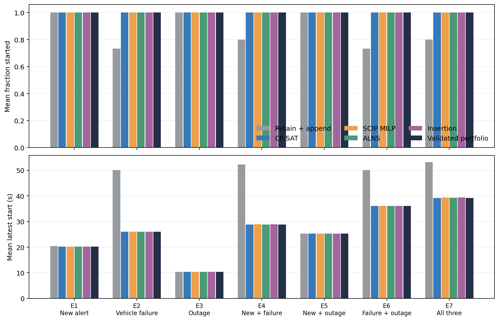
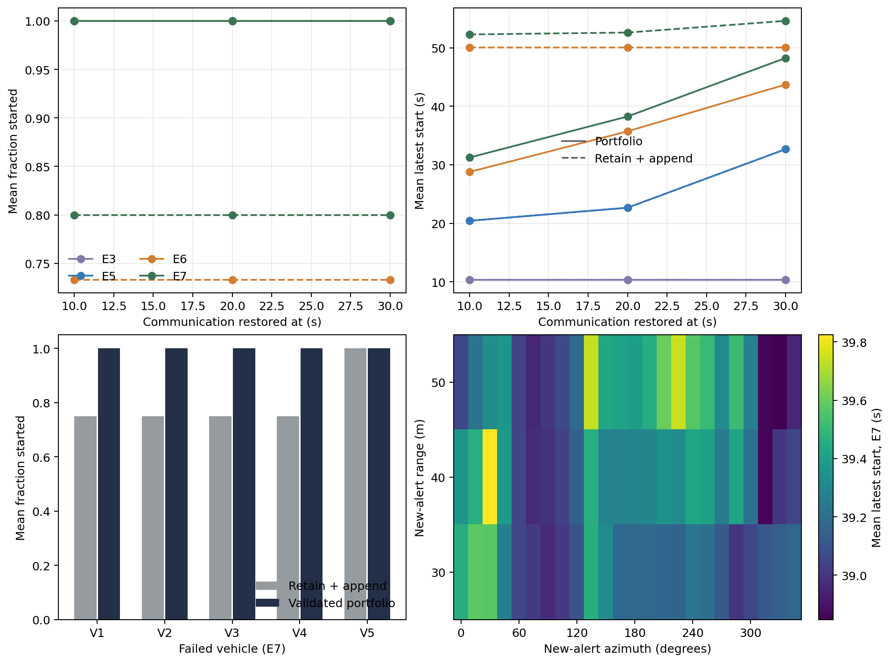
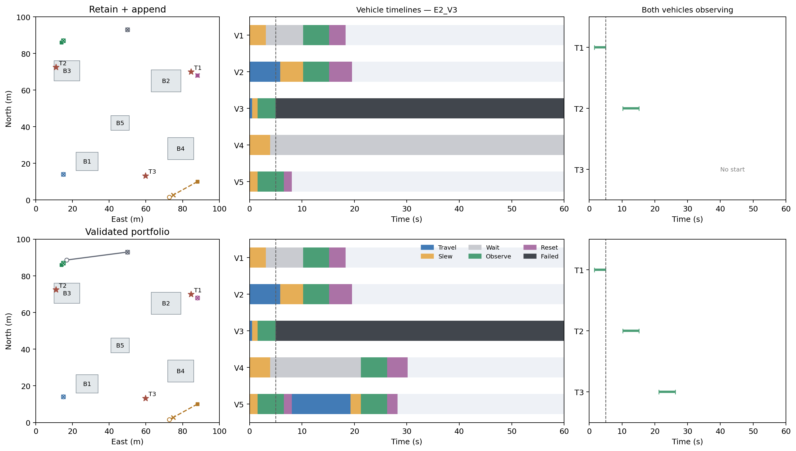
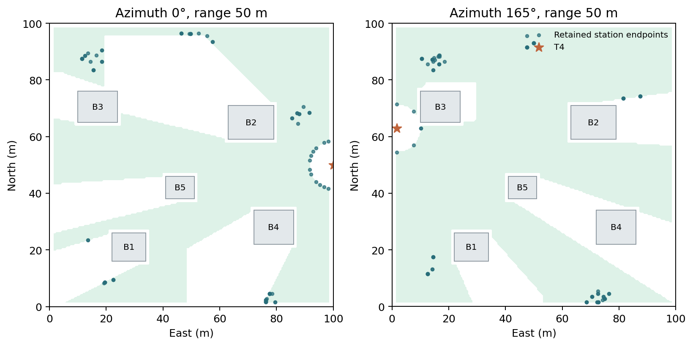

# Problem B, Question 4 — Rescheduling Under Disturbances

Technical material for independent team review. The scores come from continuous replay of the archived schedules, not from the solvers' rounded clocks. See the [reproduction record](run_record.md) and [scenario-level scores](scenario_metrics.csv).

## Event-Triggered Model

Both policies start from the unchanged optimized schedule from Question 2(2). Its joint start times for T1, T2 and T3 are 1.532, 10.204 and 10.353 s. No disturbance is known when the orders are issued at time zero. At 5 s, a failed vehicle leaves service immediately and stops occupying the travel space. Alerts that have already started remain credited; their surviving vehicles complete the reserved observation and reset phases. During an outage, preissued orders continue without modification. If a task loses a partner before its start, the other vehicle follows the old order and waits. A task that starts legally during the outage is also locked.

New instructions can take effect at 5 s without an outage or at the actual recovery time with an outage. They use the observed vehicle positions, gimbal poses and remaining locked phases. In the main experiment, all original station coordinates are fixed, but unstarted alerts may change vehicle assignments and sequence. The retain-and-append baseline neither substitutes vehicles for old tasks nor delays any executable old task. It may append T4 to pairs with spare capacity after their last old task slots. The strict-freeze check never assigns T4.

An unstarted alert is either omitted or assigned to two distinct operational vehicles at a legal station pair. The choices induce an ordered chain of tasks for each vehicle. First-task readiness is calculated from each vehicle's state and release time: return the gimbal to horizontal east before moving, travel at 3 m/s along an obstacle-avoiding route, and then aim at the target. A vehicle staying at its current station can aim directly from its actual pose. For a vehicle that next serves alert $a$ after alert $b$, readiness is

$$
r_{av}=S_b+5+g^{\rm reset}_{bv}+L_{b\to a,v}/3+g^{\rm slew}_{av},
\qquad S_a=\max(r_{av_1},r_{av_2}).
$$

The two gimbal axes move in parallel at up to 30°/s, so their maximum individual rotation time determines the slew or reset time. The earlier vehicle waits until both are ready. Each starts a 5 s observation interval, after which it must reset before reuse. An alert is counted at its legal start, not at the end of its observation. With $N$ posted alerts and $k$ starts strictly before 60 s, the score is $(k/N,t_{\rm last})$. The count has first priority; only when all alerts start is $t_{\rm last}$ the actual latest start. Otherwise $t_{\rm last}=60$ s.

The shared T4 catalogue uses a 1 m field grid, 0.25 m refinements near promising stations, and points near the 80° elevation limit. Stations must have vehicle clearance, an admissible elevation and an unobstructed 3D line of sight; the two stations must be separated by at least 3 m and have non-collinear bearings. The 40-pair cap prioritizes the best first-order horizontal RMSE (Question 2(1)) and the fastest pairs, then fills remaining slots with geometry alternatives. It does not guarantee a low-RMSE alternative for each reference vehicle pair. Travel uses a visibility graph on conservatively expanded building footprints. Independent replay checks swept clearance against buildings and minimizes each pair's center distance over every overlapping segment of their continuous trajectories.

The four methods share the same inputs, candidates, routing and 0.1 s planning clock. Only the suffix durations are rounded up. CP-SAT uses conditional readiness equalities and an explicit maximum for synchronized starts. SCIP MILP expresses the same equalities and maximum by bounded linear constraints and binary selectors. The exact methods first maximize the number of starts, then minimize the latest start when all are possible. Dual-vehicle insertion provides a common feasible starting solution; adaptive large-neighborhood search (ALNS) repairs it with randomized task removal and paired re-insertion, using ten fixed seeds per case. The final policy chooses the best validated continuous score from the four solvers and the retain policies. Time is compared only at equal $k$; any additional tie-break does not alter the official score.

## Scenario Design and Results

Twenty-four directions spaced by 15° cover the whole azimuth range. The radii 30, 40 and 50 m cover both endpoints and the midpoint; height is fixed at 50 m. All five single-vehicle failures are equally likely conditional on a failure. The recovery samples 10, 20 and 30 s represent outages of 5, 15 and 25 s: the explicit bound $t_{\rm rec}\le30$ s is used rather than extending recovery to 35 s for a nominal 30 s outage. Full crossing of the applicable factors gives the seven classes below. Six extra locations were chosen at midpoints of neighboring samples with the largest observed changes in performance or geometry, including across the 360° boundary. The resulting 144 refinement scenarios also all started every alert. No probability distribution is assumed for T4's position or the recovery time.

**Table 1. Main-sample results.** Means are scenario averages within each class; 60 s is included for incomplete cases. The dynamic column is the validated scenario-wise policy.

| Disturbance | Cases | Retain and append: mean η | Dynamic: mean η | Retain and append: mean $t_{\rm last}$ (s) | Dynamic: mean $t_{\rm last}$ (s) |
|---|---:|---:|---:|---:|---:|
| New alert | 72 | 1.0000 | 1.0000 | 20.410 | 20.265 |
| Vehicle failure | 5 | 0.7333 | 1.0000 | 50.071 | 26.066 |
| Outage | 3 | 1.0000 | 1.0000 | 10.353 | 10.353 |
| New alert + failure | 360 | 0.8000 | 1.0000 | 52.284 | 28.825 |
| New alert + outage | 216 | 1.0000 | 1.0000 | 25.246 | 25.246 |
| Failure + outage | 15 | 0.7333 | 1.0000 | 50.071 | 36.071 |
| All three | 1,080 | 0.8000 | 1.0000 | 53.165 | 39.247 |
| All main cases | 1,751 | 0.8325 | 1.0000 | 48.084 | 34.482 |

The dynamic policy increases the number of starts in 1,168 cases. Of the remaining 583 cases, in which both policies start every alert, 52 have earlier latest starts and the maximum improvement is 1.801 s. The strict-freeze baseline starts every alert in only seven cases because it does not serve T4. The difference in overall mean $t_{\rm last}$ mixes recovered starts with timing gains and is not a mean physical time saving.

**Table 2. Solver comparison.** All four methods achieve $\eta=1$ in every main case. A match uses the continuous official score. Integer proofs concern only the finite candidate model under the routing and departure rules above. The discrete timing gap in the scenario table is for the exported plan; the proof can use a different plan. Median solve times exclude common preprocessing and, for CP-SAT, MILP and ALNS, the insertion warm start. In the scenario table the recommended row gives the selected method's time, not the elapsed time of the combined policy.

| Method | Mean $t_{\rm last}$ (s) | Matches best observed score | Finite-model proofs | Median solve time (s) |
|---|---:|---:|---:|---:|
| CP-SAT | **34.482049** | **1,749** | **1,747** | **0.0305** |
| ALNS, best of 10 seeds | 34.497233 | 1,732 | — | 0.1981 |
| SCIP MILP | 34.583223 | 1,612 | 1,296 | 0.0704 |
| Dual-vehicle insertion | 34.598193 | 1,592 | — | 0.1182 |

CP-SAT is the best single method; four remaining suffixes had no pending tasks. SCIP returned 451 further feasible results without a time-optimality proof. ALNS has nonzero between-seed variation in latest start in 143 main scenarios. The scenario-wise policy improves on CP-SAT's continuous times by 0.033331 s in two cases, both involving V2's failure and recovery at 10 s with T4 at azimuth 210° (40 or 50 m). A schedule that wins on the integer clock need not win after the durations are restored. Neither the solver proof counts nor the observed success rate certify unsampled locations, alternative roads, or full continuous-space optimality.

## Representative Vehicle Timelines and Limitations

**Failure recovery, `E2_V3`.** The baseline cannot start T3, leaving $(\eta,t_{\rm last})=(2/3,60\,\mathrm{s})$. V3 withdraws at 5 s from T1, which started at 1.532 s and still counts. V5 remains in its reserved observation phase until 6.532 s and resets by 8.064 s, then travels 33.515 m and finishes aiming at T3 at 21.244 s. V4 is waiting at the other T3 station. Keeping V1 and V2 on T2 yields $(1,21.244\,\mathrm{s})$.

**No gain for outages without a failure.** The original orders handle T1–T3 without new instructions. For the 216 T4-plus-outage cases without a fault, reassigning vehicles did not improve the official score beyond appending T4. Without the outage, insertion can help: in `E4_A345_R50_V5`, V2/V4 start T4 at 7.109 s, followed by T3 at 18.404 s and T2 at 18.899 s, compared with the baseline's last start at 20.700 s.

**Latest starts under failure and outage.** In `E7_A90_R50_V2_C30`, T2 loses its partner and cannot be repaired until 30 s. V4 then drives 70.873 m around B4 to the original southeast station and needs a further 4.366 s to aim. V1 observes T4 with V3 first, resets and repoints by 42.389 s, then waits for V4. The validated score is $(1,57.990\,\mathrm{s})$ compared with $(3/4,60\,\mathrm{s})$ under retention. The same worst-case time occurs in 146 scenarios, all with failure of V1 or V2 and recovery at 30 s. These cases leave just 2.010 s of start margin, and the final observation extends beyond the evaluation window. Across the three recovery levels, the mean latest start for E7 rises from 31.237 to 38.252 to 48.252 s. Dispatch and solver latency are not added to these travel-and-operation times.

**Spatial and numerical effects.** With V3 failed and $R=30$ m, changing T4 azimuth from 120° to 135° moves V2's selected T4 station and lengthens its T2-to-T4 route from 1.856 to 15.570 m. The corresponding latest starts are 24.126 and 29.109 s; the additional 127.5° case starts by 26.277 s. In the selected sensitivity cases, reducing the clock step to 0.05 s or including starts exactly at 60 s does not change the scores. Using a half-metre grid and more candidate pairs improves one of eight cases, by about 0.006 s. Allowing fresh stations for unstarted old alerts improves ten of twelve selected cases, by up to 23.177 s. This changes the planning problem and is not counted as a benefit of rescheduling alone.

**Positioning quality.** Thirty main-sample T4 schedules were within 5° of collinearity. In reruns of these 30 cases with at least 5° clearance from both 0° and 180°, all alerts still started on time. Sixteen cases had unchanged scores. The maximum extra delay was 0.617 s; median first-order T4 RMSE decreased from 40.929 to 6.221 m. This diagnostic is based on local bearing-error propagation and does not directly measure field accuracy. A deployment requiring accurate localization should check geometry as well as the time score.

*Figure 1. Mean fraction of alerts started and mean latest start time in the seven classes.* [PDF](policy_performance.pdf)

*Figure 2. Sensitivity to recovery time, failed vehicle and T4 azimuth and range.* [PDF](disturbance_effects.pdf)

*Figure 3. V3 failure: original and replacement routes, five vehicle timelines and the intervals when both assigned vehicles are observing. The T1 bar stops at 5 s on both rows; V5's individual phase continues in the center panel. The start remains credited.* [PDF](representative_timeline.pdf)

*Figure 4. T4 observable regions and retained station endpoints for representative main locations.* [PDF](candidate_regions.pdf)

Evidence: [scenario manifest](scenario_manifest.csv), [scores](scenario_metrics.csv), [alert assignments](alert_results.csv.gz), [per-vehicle events](policy_vehicle_timelines.csv.gz), [routes and phase intervals](policy_plans_and_tracks.jsonl.gz), [sensitivity](sensitivity.csv), [targeted stress tests](paired_stress.csv), [Git archive audit](git_archive_validation.json), and [full-run audit](archive_validation.json). AI-assisted preparation; the team must verify, rewrite and disclose the assistance under the [competition's AI rules](https://www.nmmcm.org.cn/News/220.html).
